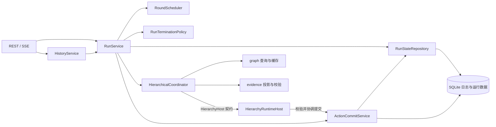

# 运行架构

工程依赖保持 `bootstart → app → common`。业务位于 `com.trs.simulation`，不依赖外部图数据库、消息队列或真实银行服务。

泄密与银行业务 Action 统一使用 `ActionPrograms` 的版本三对象本体和 `DeclarativeActionEngine`。CEL-Java 编译条件、候选对象和步骤参数；引擎执行 SET_PROPERTY / DISABLE_RELATIONS / TRANSFER_MONEY 白名单原语，验证权限、可见性和金融不变量，原子提交。业务 Action 无须逐个增加 Java 名称分支；新增原语仍需 Java 实现。历史本体在加载时适配，图谱与运行状态不重置。

`ActionLibraryService` 维护 V8 草稿 / 不可变发布修订；生成器复用模型配置与并发限制，只保存合法草稿。显式发布、绑定和场景授权后，新运行才使用该定义。完整定义随世界和运行冻结，编辑和重新绑定不改变已有回放或分支。模型决策上下文仅包含可见能力的参数规范、说明和条件提示，不发送执行程序；完整运行契约仍由引擎与人工干预 UI 使用。详细格式与资源边界见 [声明式 Action](DECLARATIVE_ACTIONS.md)。

## 推演组件

`runtime.RunService` 提供原有运行入口并持有运行锁。轮次时钟与待投递输入由 `RoundScheduler` 处理，冻结数据和审计日志由 `RunStateRepository` 读取，`ActionCommitService` 提交裁定及状态快照，`RunTerminationPolicy` 执行既有终止规则和共享预算。完整源码路径见 [第一阶段重构映射](development/REFACTOR_MAP.md)。

## 决策与状态隔离

`Model → AgentScope ReActAgent → DecisionProvider → DomainEnvironment → ActionCommitService → SQLite 事件/快照 → SSE/查询 → GUI`

- 模型仅收到授权观察，不能访问世界表、连接或任意 HTTP/SQL 工具。
- AgentScopeDecisionProvider 使用锁定并核实 API 的 Java SDK 2.0.5。支持 OpenAIChatModel 与显式 SimulatedModel；两者共用真实 SDK 工具/结构化输出流程。
- 模拟模型按当前状态、权限及反馈选择行动。模拟生成通过 AGENT_STARTED.modelMode=MOCK 标识；不是实际 LLM 自主性证明。
- World Engine 根据已注册 DomainEnvironment 插件校验 Schema、权限、可见范围及前置条件，唯一负责模拟状态变更。
- RunService 不包含银行执行逻辑；世界验证、动态生成对象的观察投影、Action Schema、效果和指标均交给领域插件。领域观察扩展点用于让账户可见的 Agent 看到对应模拟交易，不扩大其账户权限。
- 用户干预同样走领域校验，使用 USER_INTERVENTION 来源，不能冒充 Agent 模型决策。需要暂停运行与匹配 expectedVersion。

## 持久化与分支

Flyway V2–V5 增加世界/图、场景、运行、追加事件、快照、命令去重、延迟队列、分支关系和分支时钟。

SQLite 使用 WAL、foreign_keys、busy_timeout=5000；所有正式 Action 的状态、裁定、变更事件和快照在同一事务中提交。LLM 调用不持有 DB 事务。单连接模式下禁止在 JdbcTemplate RowMapper 内嵌套查询。

每次状态变更保存版本快照与 before/after 事件。HistoryService 按事件序号寻找其最近已提交版本，回放不依赖 Agent、LLM 或再次执行 Action。

第二阶段的 `ActionCommitService` 用最终候选图谱计算结构化差异，再按版本比较写入。运行状态、快照、Action 审计与 V10 的持久化收据在同一事务中提交。既有 V1–V9 迁移和历史事件保留。表内收据按运行、来源与命令键隔离；同一命令重试可以读取首次返回的状态与回执。

`VisibilityPolicy` 为运行查询、Action 上下文、委派和证据投影提供有效范围。派生交易要求可见转出和转入双方。局部视图会省略直接引用隐藏对象或关系的字段。新查询证据明确记录范围，新 Action 审计通过 `actionRunId` 关联；缺少范围的旧查询或 Action 证据，仅在可证明全图可见时用于研判。

委派先继承主从角色共有的授权。显式 `scopeIds` 是任务的最终对象范围上限，派生对象也必须在清单内，且其关联端点仍须可见。省略范围时沿用角色的派生可见性。图谱投影、缓存键和查询审计共用每次查询计算出的有效范围。

Fork 原子复制精确状态、冻结场景、当时待处理事件和受限反馈记忆。子分支事件序号从 1 开始。兼容轮次模式保留原有 `base_time` 和从 0 开始的 `step`。严格事件模式从历史序号恢复逻辑时间、图谱版本、研判轮次及当时仍未完成的工作，继承工作保持相对入队顺序。比较使用实体/关系实际值差异和插件指标。

V11 扩展现有延迟队列，旧记录保留交付标记。严格调度每批最多领取 10 项，按同一时刻预算提交该时刻的工作，即使需要多批领取。领取之后的时钟、投递审计和工作状态同事务写入。进程重启时回收尚未提交的领取。输入绑定的 Action 对应的工作确认及领域事件入队与 Action 事务共同提交。

V12 将严格模式的待研判轮次及原步进键随投递一并持久化。需要研判的普通输入投递后仍处于处理中，研判完成事件与工作完成标记同事务保存。暂停和重启优先继续原时点、原轮次。模型调用在写事务之外，已提交 Action 的检查点随业务状态和收据落盘。历史分支只继承分支位置之前已存在且尚未关闭的研判，以及在该位置已经生效的 Action 检查点。

严格模式的逻辑时间、研判轮次、图谱版本和审计序号独立。SSE 审计保留无图谱变化的时钟推进；数据库事务和回放均无模型重调用。调度使用单进程运行 lease；在当前时点的等待输入有处理结果之前，队列保持该时点。已完成 Action 的持久化命令回执与输入确认共同防止恢复或重复投递再次产生效果。

## 前端和实时协议

Vue 3 + TypeScript + Pinia + Vue Router hash 路由。Cytoscape 反映后端实体/关系和状态；对象高亮同时提供标签与图例。ECharts 比较潜在范围/模拟暴露/干预数量或账户余额，并有可读数据表。

SSE 每条记录具有持久化 sequence；Last-Event-ID 或 after 恢复，前端按 sequence 去重排序。SSE 不是存储。连接关闭/超时会清理后台轮询。模拟计算与历史播放分离：计算控制调用生命周期/step，播放、拖动、事件跳转只读取 replay。

`RunStudio.vue` 通过 `usePlayback` 按播放速度读取历史事件位置。事件序号、引用跳转与 SSE 更新仍由工作台协调。

## 两个领域

InformationEnvironment：关闭同步、撤销共享、模拟审核、受启用直接关系约束的假设传播。可达关系不是已发生传播的事实，模拟效果保留 SIMULATED 标记。

BankEnvironment：账户余额使用整数分；转账金额用 BigDecimal 检查精度，禁止负数、自转、余额不足、币种不匹配和越权。转出/转入同时提交并保存模拟交易；风险 Agent 可添加模拟标记。总金额守恒，不调用真实业务写接口。

## 模型与边界

模型配置保存安全参数，密钥用 AES-256-GCM 加密，主密钥位于 `data/model.key`，权限0600；生产路径 `/data/model.key`。返回前端不包含密钥或密文。也支持环境变量引用。mock://local 不发送外部模型请求。

每个世界≤200实体/1000关系，场景≤20 Agent/20轮/2000事件；每运行≤50次模型决策。服务器预算在 studio.simulation 配置。SDK每次决策≤3迭代和3次只读工具查询，模型超时1–60秒，并发1–8，观察JSON≤32000字符。Token上限采用保守预留而非真实计费。当前仅单实例串行EVENT_DRIVEN，TURN_BASED模式未实现。
