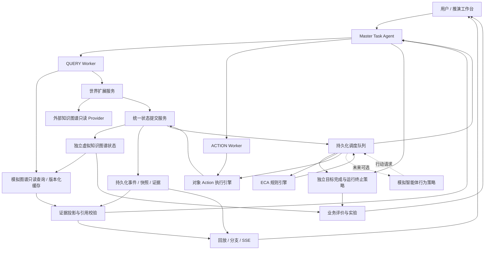
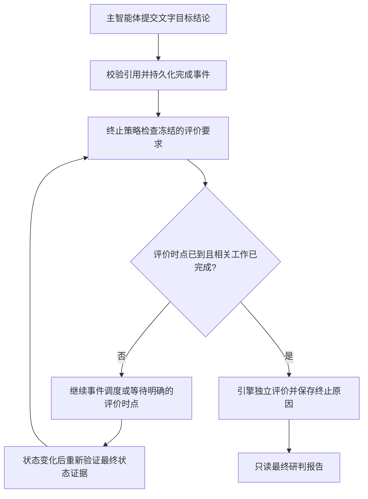
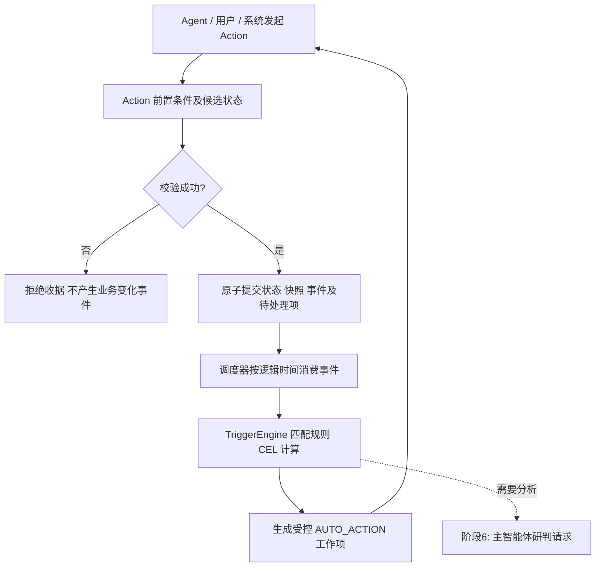

# GASS 架构演进开发实施指南

**用途：** 提交给本地编码智能体（Codex、Claude Code 或其他本地 AI 开发工具）作为分阶段开发任务书。  
**项目：** [czhcc/gass](https://github.com/czhcc/gass)  
**版本：** 修订版 2（2026-11-25），替代此前实施指南。  
**依据：** 《GASS 知识图谱智能体推演系统——理论基础、源码评审与演进设计》及两次静态源码评审。最新评审基线为 main 提交 [`1e11b598aebf3b5f59c7ee7713ec4c1c0591c1cf`](https://github.com/czhcc/gass/commit/1e11b598aebf3b5f59c7ee7713ec4c1c0591c1cf)，提交时间 2026-11-25 14:26:55（UTC+8）。相对旧基线 `4975f174` 新增 2 个提交、涉及 19 个文件。主要功能提交 `813c3cf`（完善推演目标研判与图谱证据复用）。[版本差异](https://github.com/czhcc/gass/compare/4975f174d20cea21e604001d1fb70a8d02448560...1e11b598aebf3b5f59c7ee7713ec4c1c0591c1cf)。实施时以本地实际 checkout 为准。  
**原则：** 第一阶段先调整代码结构；先稳定内核，再扩展机制；每阶段单独验收，不一次性重写。  
**范围说明：** 下文新增类、接口、表名和配置均为建议设计，不表示已经存在；不要求引入新的框架。具体命名可遵循仓库已有约定，但必须保留本文规定的语义、边界和验收能力。

---

## 0. 最新基线与修订重点（开发前必读）

本次版本已强化任务智能体的研判闭环，但未实现独立世界演化或外部图谱导入。以下能力属于现有代码，不能作为新增功能重复开发。

| 最新实现 | 现有代码 | 必须保留的行为 |
|---|---|---|
| 用户目标优先 | HierarchicalCoordinator.run | 使用保存的 objective，查询任务不无故执行 Action |
| 文字目标提前完成 | CompleteObjective、RunService.checkTermination | complete_objective 校验引用并记录 OBJECTIVE_COMPLETION_RECORDED；无 CEL 条件时允许按现有规则提前结束；业务结果仍是 NO_CONDITIONS |
| 图谱路径排名 | GraphQueries.rankPaths | 有向启用边、不重复节点、类型计数、并列最优、maxDepth≤64、50,000 路径前缀预算及完整性标志 |
| 查询计算缓存 | RunGraphReadService.read / QueryKey / GraphRead | 128 项 LRU；runId、version、精确 scope、工具及规范化参数隔离；每次查询仍有审计记录及 reused 标记 |
| 证据复用 | ObjectiveEvidence、recentGraphEvidence | 当前版本查询证据与历史 Action 证据分开；授权及截断边界；状态变更后不复用旧版本作为当前证据 |
| 最终研判 | ObjectiveReview、ObjectiveResult.vue、taskNarrative.ts | conclusion、history、finalState、limitations、evidenceSequences；旧报告兼容；可读文本不修改原始审计记录 |
| 回归测试 | ObjectiveGraphQueryTest、HierarchyModelContractTest 等 | 覆盖路径排名、授权隔离、跨轮证据复用、提前结束和历史/最终状态区别 |

当前仍待建设：本体属性约束、独立模拟时钟、持久化衍生事件队列、ECA、外部知识扩展、动态授权、显式因果关联及实验指标。Action 执行引擎、已有数据库迁移 V1–V9 和核心技术栈没有因这次提交改变。第一阶段只拆分结构，不修改以下语义问题；将问题登记到指定阶段处理。

| 待处理问题（静态审查） | 处理阶段 |
|---|---|
| 查询证据完整性、旧事件缺少 scopeIds、可见范围计算分散 | 阶段2统一可见性；阶段5扩展外部数据覆盖语义 |
| ObjectiveEvidence 通过 sequence±1 关联 Action 事件，未来插入衍生事件会影响可靠性 | 阶段2引入显式 actionRunId，阶段4补齐因果链 |
| complete_objective 与整个运行的终止仍耦合；未来轮次约束主要依赖提示词 | 阶段3结构化评价策略及终止门禁 |
| 证据序号有效不代表内容足以证明任务目标 | 阶段3明确完成语义；阶段6/7增强证据和评价 |
| 旧时钟按轮次推进、每轮最多投递10个事件 | 阶段3处理，阶段1保持原状 |

## 1. 给本地 AI 的总任务

在现有 GASS 上完成增量架构演进，将其建设为基于动态本体和声明式对象 Action 的分层智能体推演平台，支持三种驱动机制：

- **Agent-driven：** 主从任务智能体主动分析、规划、调用对象 Action、实施干预。
- **Event-driven：** 状态变化、领域事件和 ECA 规则驱动虚拟世界自动演化。
- **Knowledge-driven：** 根据推演需要，从授权的外部知识图谱读取事实并扩展当前虚拟世界。

保留任务智能体与未来模拟智能体的区别：现有 Master / QUERY / ACTION 均属于 Task Agent，模拟智能体（Simulation Agent）是世界中对象自身的行为代理，不是现有主智能体的从智能体。Rule Engine 是确定性执行组件，不是 LLM 智能体。三种业务行为发起方共享对象 Action 引擎，知识导入则独立走世界扩展服务，共用状态提交基础设施。

### 1.1 不得改变的技术路线

- 后端 JDK 21、Spring Boot 4、Maven、AgentScope Java SDK、CEL-Java、SQLite、Flyway；前端 Vue 3、TypeScript、Pinia、Cytoscape、ECharts、Tailwind。以本地锁定的版本为准，不无故升级。
- Maven 依赖方向保持 `bootstart → app → common`；不新增独立微服务，不引入 Kafka、Drools、外部图数据库作为必需依赖。
- 对象类型拥有 Action，关系类型不拥有 Action；所有业务状态变更仍经过声明式 Action 与领域校验，不允许模型提交任意状态补丁、SQL、脚本或真实业务写请求。
- 保留现有场景、运行、分支、回放、目标条件、事件证据、SSE、Mock/真实模型模式和既有 API；新增能力默认关闭或保持原有语义，除非阶段明确安排兼容迁移。
- 外部知识图谱只读，虚拟世界可修改；禁止把模拟结果回写真实知识图谱。
- 所有涉及权限、业务不变量、事务、预算、时间、事件顺序和最终业务判定的逻辑由确定性程序负责，不交由提示词保证。

### 1.2 目标架构



说明：图中查询/导入工具为受控调用，不代表 QUERY Worker 天然具有导入权限；所有 Action，包括规则触发和人工干预，统一校验。Rule Engine 只生成调度请求，不递归执行 Action。事件日志与待处理队列语义不同，不允许回放触发新规则。

## 2. 执行纪律与阶段门禁

### 2.1 开始前

1. 阅读本地 `AGENTS.md`、`docs/CODING_STANDARDS.md`、`DESIGN.md`、`README.md`、`docs/ARCHITECTURE.md`、`docs/DECLARATIVE_ACTIONS.md`、`docs/HIERARCHICAL_RUNTIME.md`、`docs/API.md`、`docs/ACCEPTANCE.md`；检查现有源码和测试。
2. 记录 `git status --short`、`git branch --show-current`、`git rev-parse HEAD`、当前 Flyway 最高版本。不要覆盖用户未提交的修改，不主动创建额外 worktree。发现本地差异时按真实代码调整设计，并记录差异。
3. 遵循仓库约定：禁止在 main 上修改代码；创建功能/修复分支，例如 `refactor/simulation-structure`。未经用户指示不要推送；不要擅自合并 main。每阶段以独立提交为单位，保留可追溯历史。
4. 在改动前建立基线：运行后端 Maven 测试、前端 pnpm 测试和构建，并记录已有失败。保存银行与信息领域的典型 Mock 场景 API、事件序列、业务评价、回放与分支结果作为回归参照。新增保存文字目标提前完成、历史 Action/最终图谱、路径排名和缓存复用的基线；比较语义，不比较随机 ID 或真实耗时。不要提交 SQLite 文件、凭证、构建产物。

### 2.2 测试与交付

按照仓库现有脚本执行，通常为：

```bash
# 项目根目录；必要时使用本地已安装的 Maven/JDK 21
cd backend && mvn test
# 返回项目根目录
cd ../frontend && pnpm install --frozen-lockfile
pnpm test
pnpm build
```

测试命令如与本地 package.json 或 README 不同，以仓库定义的非交互式命令为准。若命令失败，保留真实日志、失败用例及原因，不删除、跳过、弱化断言，不用假结果冒充通过。后端 JUnit Jupiter，前端 Vitest + jsdom。先编写特征/回归测试，再修改实现。Java 类和公共方法使用 Javadoc，`@author` 取当前系统 `whoami`；包名前缀 `com.trs`。所有用户文案提供中英文，表单遵循既有设计规范。

每阶段完成后必须输出：目标完成情况、变更文件、关键设计与偏差、迁移情况、API 兼容情况、测试命令及实际结果、未解决问题、Git 提交号。建议使用 `docs/development/PROGRESS.md` 记录。未通过该阶段验收不得开始后续阶段；如果环境阻塞，明确阻塞，不宣称完成。

## 3. 开发阶段总览

| 阶段 | 内容 | 优先级 | 阶段交付目标 |
|---|---|---|---|
| 1 | 代码结构调整与职责拆分 | P0 | 行为不变，独立 graph/evidence，保留新版研判闭环 |
| 2 | 形式化本体、Action 和状态提交 | P0 | 类型约束、统一可见范围、原子提交、显式 Action 关联 |
| 3 | 模拟时钟与持久化事件调度 | P0 | 时钟解耦、可靠调度、任务完成与运行终止分离 |
| 4 | ECA 自主传播 | P0 | 属性变化自动触发衍生 Action，因果链可追溯，无 LLM 也可运行 |
| 5 | 外部知识图谱按需扩展 | P0 | 安全、可回放的局部世界导入 |
| 6 | 事件驱动任务智能体及可视化 | P1 | 智能体按需研判、用户可查看因果路径 |
| 7 | 指标与实验评价 | P1 | 区分导入/业务变化、支持可比较实验 |
| 8 | 显式任务规划 | P2 | 任务 DAG、依赖和重规划，可按需启用 |
| 9 | 模拟智能体扩展 | P2/可选 | 对象自主行为策略，不改变任务智能体架构 |

阶段 1–5 是核心建设范围；阶段 6–7 完成工作台和评价闭环；阶段 8–9 仅在前面稳定后实施。第一阶段绝不能与新功能混合开发。阶段 2–4 共享状态提交/调度基础，按顺序推进；阶段 5 复用此基础，但导入不产生默认业务传播。阶段 7 中的导入指标兼容最小能力必须提前在阶段 5 完成。

---

# 阶段 1：代码结构调整（首要任务）

## 4. 现有问题与重构目标

当前后端核心逻辑集中在 `backend/app/src/main/java/com/trs/simulation/`。已审查的 `RunService.java` 接近 1000 行，兼具生命周期、运行调度、状态持久化、Action 裁定、智能体运行上下文、预算和结果判定；`HierarchicalCoordinator.java` 最新版约 45.3 KB（旧版约 33.7 KB），同时承担智能体组装、委派工具、Worker 工具、证据投影、目标完成与最终研判。`RunService.java` 最新版约 54.7 KB。新增 ObjectiveEvidence 已具备独立职责，应迁移而非重写。`SimulationTypes.java` 汇集多种跨层 record。先建立清晰的职责边界，避免未来把事件、规则、外部连接器继续堆入上述类。

**阶段约束：只做行为保持型重构。** 不增加 ECA、不新增外部调用、不改变 clock 算法、不修复旧时间语义、不新增数据库迁移、不替换 SDK、不改变权限和业务逻辑。发现现有缺陷先写入问题清单，交给后续对应阶段；不在重构中混入修复。公共 API、JSON、事件名、事件顺序、默认配置、业务结果与历史记录兼容。

## 5. 建议目标目录与现有文件迁移表

第一阶段建议仍在 `app` 内使用 `com.trs.simulation` 子包，保留 Maven 模块。以下目录为目标，按现有依赖和可见性增量落地，不要求提前建立空类或空包。

```text
backend/app/src/main/java/com/trs/simulation/
├── SimulationTypes.java             # 第一阶段保留兼容的跨层 DTO/record
├── api/                             # REST Controller、HTTP 适配
├── ontology/                        # 本体定义、校验（后续扩展）
├── world/                           # 世界模板、状态与可见性接口
├── graph/                           # 图算法、只读查询、版本化缓存
├── evidence/                        # 证据投影、引用校验、历史关联
├── action/                          # Action 库、程序、原语、CEL 契约
├── agent/                           # SDK、主从智能体、模型决策与工具
├── runtime/                         # 运行生命周期与统一提交
├── event/                           # 事件存储、调度（分阶段实现）
├── history/                         # 快照、回放、分支
├── evaluation/                      # 目标与业务指标
├── domain/                          # 领域 SPI
│   ├── bank/
│   └── information/
├── model/                           # 模型配置与凭证管理
├── config/                          # Spring 配置、场景装配
├── common/                          # Json 等内部公共工具
├── trigger/                         # 阶段4新增，不提前建空模块
├── external/                        # 阶段5新增
├── expansion/                       # 阶段5新增
├── planning/                        # 阶段8新增
└── behavior/                        # 阶段9可选新增
```

| 目标包 | 当前主要文件 | 调整说明 |
|---|---|---|
| api | SimulationController、ContinuationController、HierarchyController、ActionLibraryController | 保留所有 REST 路径、DTO 字段、状态码；控制器不承担核心规则 |
| action | ActionLibraryService、ActionPrograms、DeclarativeActionEngine、ActionToolSchemas、CelExpressions | ActionToolSchemas 可留 agent 子包，按实际依赖决定；执行与工具投影分离 |
| agent | HierarchicalCoordinator、HierarchyHost、HierarchyData、HierarchyMockModel、AgentScopeDecisionProvider、DecisionProvider、SimulatedModel | SDK 组装、授权、工具调用、任务报告不直接持久化业务状态 |
| world | WorldService | 模板与运行状态分离 |
| graph | GraphQueries、RunGraphReadService | 保留 rankPaths、GraphRead、QueryKey 和 LRU；GraphQueryCache 可按复杂度抽取 |
| evidence | ObjectiveEvidence、TaskEvidence | 迁移原有逻辑；抽取 EvidenceProjectionService / EvidenceReferenceValidator 时保持引用与授权行为 |
| runtime | RunService | 保留兼容 facade，逐步提取生命周期、时钟、Action 提交、预算与运行上下文 |
| history | HistoryService | 保留快照、分支、回放；通过接口读取证据 |
| evaluation | BusinessEvaluation、ObjectiveDraftService；从协调器提取 ObjectiveCompletionService、ObjectiveReviewService | 保留引擎业务判定与文字研判的独立性；SDK 调用可由 agent 适配器提供 |
| domain | DomainEnvironment、BankEnvironment、InformationEnvironment、InformationActionEngine、InformationOntology | 通用 SPI 与领域实现分离；不得在 RunService 增加领域 if/switch |
| model | ModelService | 保持现有模型连接与密钥安全边界 |
| config | ApiConfiguration、WorldCatalogInitializer、ScenarioProfiles、DemoService、Examples | 示例及场景装配不侵入核心引擎 |
| event | EventStreamService | SSE 是事件读取适配器，可放 api；不能充当调度或事件存储 |
| common | Json | 保持序列化行为；避免引入跨 Maven 模块反向依赖 |

说明：不必机械搬迁全部类。对于包级访问密切相关的类先成组迁移，通过最小接口消除跨包依赖；不为迁移而将所有方法改 public。第一阶段可保留 `SimulationTypes` 作为兼容契约，后续逐步拆分内部模型与传输 DTO；不要一次性修改所有 record 的 JSON 格式或类型标识。

## 6. 具体子任务

### 1.1 基线与依赖分析

- 统计核心类行数、注入关系、包级访问、测试直接引用、Spring 扫描范围、反射/序列化类型名及配置引用。
- 确认现有 `bootstart` 扫描能发现迁移后的 `@Service`、`@Component`、`@Controller`；测试加载实际应用上下文。
- 为 API JSON、事件顺序、权限/可见范围、事务回滚、分支和历史回放补充特征测试。已有基线失败单独记录，不掩盖。
- 输出 `docs/development/REFACTOR_MAP.md`：现有文件 → 新包 → 依赖变化 → 风险与回滚点。

### 1.2 包迁移

按 `common/config → model → domain → action/world/graph → evidence/evaluation/history → agent/runtime → api` 的可编译小步实施；实际依赖决定细节。每批调整 import、package-private 调用、测试、Spring 配置和文档路径，编译并运行相关测试后再继续。使用 Git 可追踪的移动；不要一边移动一边格式化整个仓库。

### 1.3 拆分 RunService（第一阶段重点）

| 建议组件 | 从当前实现抽取的职责 | 第一阶段限制 |
|---|---|---|
| RunService | create/step/pause/resume/stop/delete/recover 等外部入口 | 保留调用方式，负责运行生命周期和协调 |
| RoundScheduler / SimulationClock | prepareRound 内的时钟与到期事件处理 | 完全保持旧公式及投递顺序；阶段3才修改 |
| RunStateRepository | state/replay、冻结世界和场景读取、持久化 SQL | 保留表和序列化格式；不得在 RowMapper 内嵌套查询 |
| ActionCommitService | commit、状态变更日志和快照写入 | 保持原事务边界及事件顺序；统一提交在阶段2增强 |
| HierarchyRuntimeHost | RuntimeHost 的授权、task、receipt、调用预算等接口实现 | 依旧通过受控运行上下文，不让 agent 直接访问 JDBC |
| RunBudgetPolicy / TerminationPolicy | 预算、停止原因、checkTermination、evaluateHorizon、reviewAtHorizon | 保持提前完成、NO_CONDITIONS 与 OBJECTIVE_REVIEW_COMPLETED 等旧行为和错误码 |
| ScheduledInputRepository | 注入及延迟事件查询 | 保持原事件表和幂等语义 |

重点：现有 `synchronized`、调用 lease、取消、版本检查、事务范围必须在抽取后等价保留。不能用不同 service 的各自 `synchronized` 替代原来同一把锁而引入并发漏洞；可显式保留共享协调锁或由 RunService 持锁调用。Spring `@Transactional` 自调用问题需注意，现有 TransactionTemplate 可先保留。不要在持锁写事务中进行外部 LLM 调用。

### 1.4 拆分 HierarchicalCoordinator

保留主智能体与 Worker 的协作语义。建议抽取 `AgentFactory`（SDK 构造与关闭）、`DelegationToolFactory`（受控任务委派）、`WorkerQueryTools` / `WorkerActionTools`（只读查询/行动提交）、`TaskResultAssembler`（结构化收据/报告）、`ModelInvocationGuard`（预算及并发控制）。当前工具名、参数 schema、提示词语义、角色授权、每任务行动上限、SDK Mock 和真实调用路径必须保持；不增加新智能体角色，不更换 SDK。

补充最新版本的拆分任务：

| 目标组件（可合并相近职责） | 从当前代码迁移的内容 |
|---|---|
| AgentContextBuilder | Invocation.overview、当前版本 recentGraphEvidence、上下文长度控制 |
| EvidenceProjectionService | queryEvidence、历史 Action/最终图谱投影；复用 ObjectiveEvidence |
| EvidenceReferenceValidator | usableForCompletion、visibleQuery 等证据验证；阶段1保持原语义 |
| ObjectiveCompletionService | CompleteObjective 的 summary/引用校验、完成事件记录；工具适配器仍由 agent 管理 |
| ObjectiveReviewService | conclude、boundedReviewText、证据列表、最终报告与失败回退 |
| InvocationState | 委派/Action 次数、objectiveCompleted、取消状态；每次运行/轮次隔离，不可变为全局单例状态 |

`HierarchyHost.record` 新版返回 long sequence，抽取后必须继续返回实际持久化事件序号。保留 `complete_objective` 的关闭委派、证据引用、最终研判、旧构造器及序列化兼容。第一阶段不引入新的评价字段、关联 ID、权限规则或缓存策略；已知问题登记到 PROGRESS.md。依赖方向避免 agent/evidence/evaluation/runtime 形成循环：通过已有契约或窄接口读取状态与事件，禁止跨包直接改写运行状态。

### 1.5 前端结构检查（轻量）

保持现有页面、导航与国际化文案。仅将 `RunStudio.vue` 等大组件中已有的运行控制、SSE、播放与事件呈现逻辑在测试覆盖下抽成 composable 或展示组件（如 `useRunLifecycle`、`useEventStream`、`usePlayback`）；不重新设计 UI，不提前增加触发器页面。保留 ObjectiveResult 的 history/finalState、实际 evaluatedRound、原始研判文本展开、引用跳转；taskNarrative.ts 的可读化只是显示层转换，不改变事件原文。若现有前端拆分已经满足要求，记录后跳过本子任务。

### 1.6 验收

- [ ] Maven 模块依赖方向不变，Spring 应用上下文正常加载；前端构建和测试正常。
- [ ] 银行及信息场景的现有测试、目标判定、操作收据、SSE 顺序、回放和分支保持兼容。
- [ ] 无新增数据库迁移，无已有 API 破坏，无行为修复或功能新增混入重构。
- [ ] 原有同步/事务/取消与版本冲突测试仍通过；无未经授权的跨层直接写状态。
- [ ] 源码路径、架构图、`REFACTOR_MAP.md`、进展记录同步更新；单独提交重构。

建议现有回归重点：`DeclarativeActionEngineTest`、`ObjectActionRuntimeIntegrationTest`、`HierarchicalFrameworkIntegrationTest`、`HierarchyGatewayIntegrationTest`、`HierarchyModelContractTest`、`SimulationIntegrationTest`、`ContinuationIntegrationTest`、`RunTerminationIntegrationTest`、`ActionLibraryIntegrationTest`、`RunStudio.test.ts`、`HierarchyTrace.test.ts`、`ObjectActions.test.ts`。以本地存在的测试为准。

新增版本专项回归（优先扩展已有测试，避免重复造 fixture）：

| 回归项 | 基线行为 / 验收 |
|---|---|
| 用户目标优先与 QUERY 工具 | 不因角色默认目标或无关告警执行无关 Action |
| ObjectiveGraphQueryTest | 方向、启用边、唯一节点、并列路径、深度/访问预算、complete/tiesTruncated 保持 |
| 缓存复用 | 同运行同版本同精确授权集合、同规范化参数命中；不同 runId、分支、scope、version 不命中；reused 审计不丢 |
| 跨轮证据复用 | 当前版本证据可复用；Action 改变状态后不复用旧查询为当前证据 |
| 完成工具 | 有效引用提前结束；错误、越权、过期或不完整引用仍拒绝；完成后不继续委派；有 CEL 条件仍走既定 horizon |
| 历史与最终状态 | 已执行 Action 的历史写入仍可见；后续禁用关系仅影响当前状态；NO_CONDITIONS 不等于自动判定达成 |
| 前端及旧数据 | ObjectiveReview 新旧 JSON 兼容；RunStudio、HierarchyTrace、EventDetails 原有回放/引用/文案保留 |

建议在阶段1新增上述缺失的特征测试；对已经存在的缺陷仅登记，不将“修复未来轮次”之类行为变更混进重构提交。

---

# 阶段 2：形式化本体、Action 与状态提交

## 7. 目标与实现

理论：情境演算、STRIPS/PDDL 行动模型、知识表示与类型约束。已有 `ActionProgram.conditions/operations/parameterOptions`，无需重新设计 Action。扩展类型约束和统一变更提交，供规则、导入与调度使用。

### 2.1 本体约束

新增可选 `PropertyDefinition`（code、dataType、required、mutable、defaultValue、constraintExpression）、`RelationDefinition`（类型、允许端点、可选基数约束）、`StateConstraint`（CEL 不变量）。定义属性允许的读写规则、未知属性策略及金融保护字段；老本体采用兼容模式，新本体启用严格验证。所有图谱变更路径共用验证器；已有领域不变量不得被通用配置绕过。对迁移前的 JSON 提供兼容构造/反序列化适配，冻结旧运行契约，不改写已发布 Action。

### 2.2 Action 模型与原语

保留 `ActionDefinition`、Action 库草稿/发布、绑定和冻结。可新增 `ActionSimulationSpec`（role、duration、读写范围提示、声明领域事件）；`role` 是推演语义，不取代原业务分类。读写范围仅是规划提示，执行时必须计算实际变更并校验。

将 `SET_PROPERTY`、`DISABLE_RELATIONS`、`TRANSFER_MONEY` 提取为开发者注册的 `ActionPrimitive` 白名单实现（不要允许动态加载任意代码）。第一批可增加 `ENABLE_RELATION`、`UPDATE_RELATION_PROPERTY`、`CREATE_ENTITY`、`CREATE_RELATION`，但仅在具备类型、端点、授权、ID 与资源预算校验后开放；非必要原语延后。转账仍走专用安全原语，禁止 SET_PROPERTY 等绕过金融不变量。若同一 Action 写多个字段，以最终候选状态为准，不对未提交的中间状态触发业务事件。

### 2.3 统一状态提交与 StateDiff

建议内部命令含 `runId`、`commandId`（幂等键）、`expectedVersion`、`origin`、`actorId`、`taskId`、`causeRef`；候选结果含 `nextState`、`changes`、`domainEvents`。`StateDiffEngine` 计算属性、实体和关系的确定性 before/after；区分缺失属性与 null，统一数值比较语义。由统一 `StateCommitService` 检查版本、授权、预算与领域/本体不变量，再原子保存状态、快照、收据与变化记录。Action 无实质变化不递增图谱状态版本；读操作可记日志但不能产生属性变化事件。重复 commandId 应返回既有收据，冲突载荷拒绝。

统一 origin：`INITIALIZATION`、`EXTERNAL_IMPORT`、`AGENT_ACTION`、`USER_INTERVENTION`、`SYSTEM_RULE`、`SIMULATION_AGENT`、`HISTORY_REPLAY`（回放仅用于来源分类，不实际提交）。旧来源值保留兼容读取；不要混淆 `SIMULATED` 证据与发起身份。阶段2只持久化结构化状态差异，不启动业务规则。

### 2.4 统一可见范围与显式证据关联（最新版本新增要求）

- 引入 `VisibilityPolicy` 或等价服务，统一从冻结场景、当前状态、领域投影、任务委派限制计算有效对象和关系范围；供 DeclarativeActionEngine、DomainEnvironment、HierarchyHost、RunGraphReadService、ObjectiveEvidence 共用。显式区分可读、可导入、可执行 Action；有效委派范围不得扩大角色权限。为阶段5的运行级动态授权预留接口，不提前实现导入。
- 现有查询缓存继续复用；键须包含 runId、图谱状态版本、精确有效 scope、工具和规范化参数。若属性级权限或覆盖范围元数据独立变化，额外纳入权限/覆盖版本。缓存仅存不可变投影；不以缓存命中代替权限检查、引用检查或审计。避免全局锁长时间持有耗时计算，必要时后续以测试保障并发语义。
- 当前 `ObjectiveEvidence.visibleQuery()` 对缺失 scopeIds 的旧事件有兼容分支。新版证据强制记录有效范围；旧事件仅在可证实全范围权限或可以从历史授权可靠重建时用于当前研判，否则标为范围未知并拒绝局部授权引用。拒绝仅依据 targetId 可见就泄露跨对象参数或回执；按相关对象/字段做投影。
- 在统一提交阶段为新 Action 增加稳定 `actionRunId`，关联 ACTION_PROPOSED / ACTION_ACCEPTED / ACTION_REJECTED / WORLD_STATE_CHANGED / ACTION_TASK_RECEIPT，保存 inputVersion、outputVersion 与 runId。`ObjectiveEvidence.historicalActions` 优先按显式 ID 查找；对老事件仅保留受约束的相邻序号兼容读取，不能重写旧审计记录。阶段4将 causeEventRef、ruleRevision、correlationId 纳入完整因果链。
- 将搜索是否完整、返回结果截断、授权范围、证据时间/版本、任务所需证据充分性分开表达。序号合法不代表结论已被证明。对于 `tiesTruncated`，首版保持保守策略；如需支持“返回任一最优路径”，应通过显式目标证据要求验证完整搜索和返回至少一条最优结果，不可放宽“全部并列路径”目标的条件。未形式化的文字目标只能表示已研判，不升级为引擎判定达成。

### 2.5 验收

- [ ] 老 Action 契约与已冻结运行仍可读取、回放、分支；原有三种原语行为一致。
- [ ] 属性类型、关系端点、受保护字段、非法状态约束、越权访问均拒绝；候选状态整笔回滚。
- [ ] 差异记录准确，no-op 不产生状态变化；多步 Action 只提交一次版本。
- [ ] 两个调用使用相同旧版本时仅合法提交成功；幂等重试不重复转账；状态与日志失败一起回滚。
- [ ] 统一权限下查询、Action 能力及证据引用一致；不同授权范围隔离缓存；无 scopeIds 的旧记录不泄露数据。
- [ ] 新事件插入 Action 审计序列之间仍可按 actionRunId 正确重建历史；老事件正常回放；no-op/拒绝无虚假状态变化。

理论形式：`F(S, a) -> (S', Δ, E)`；任何不合法的 Action 均不改变 S。具体迁移以本地最高 Flyway 版本之后追加；当前审查版本最高 V9，不修改 V1–V9。

---

# 阶段 3：模拟时钟与持久化事件调度

## 8. 目标与实现

理论：离散事件仿真（DES）。之前审查的 `RunService.prepareRound()` 使用 `base_time + step + 1` 并按每轮 `LIMIT 10` 投递事件，且轮次更新、事件投递、状态时钟更新分为多次事务。该设计适合旧轮次驱动，但不适合严格事件时间。本阶段在阶段1抽出的调度服务基础上改变语义，同时保留 legacy 模式。

### 3.1 独立时间维度

- `round`：任务智能体的研判轮次；`simulationTime`：逻辑时间；`stateVersion`：已提交业务图谱状态版本；`eventSequence`：追加审计顺序。四者独立。
- 新场景可选择 `TASK_DRIVEN`（兼容轮次模式）和 `EVENT_DRIVEN`（严格逻辑时钟）；注意当前文档已使用 EVENT_DRIVEN 术语，不能静默改变老场景语义，应通过显式运行契约版本或模式映射保持兼容。冻结模式与时间单位。
- EVENT_DRIVEN 取下一个待执行事件的 due time，单调前进；同一逻辑时刻待处理事件未清空不得推进。无事件时进入 quiescent（静止）或根据明确定义的 horizon 结束/请求智能体，不能空转。LLM 耗时和外部 I/O 不推进模拟时间。
- 同时刻事件按 `dueTime → priority（约定高值优先）→ enqueueSequence → id` 排序。优先级与后续规则冲突策略写入文档，避免用随机 UUID 决定顺序。

### 3.2 调度队列与可靠性

建议新增 `ScheduledWork`、`SimulationScheduler`、`SimulationClock`、`ScheduledWorkRepository`。持久化工作项可包含 `id/runId/type/dueTime/priority/enqueueSequence/payload/status/attempts/causeRef/dedupKey`。类型第一版至少支持外部输入与领域事件，阶段4新增 AUTO_ACTION。状态明确 PENDING、PROCESSING、COMPLETED、FAILED/CANCELLED；单实例串行模式，无需消息中间件。阶段3可适配已有 `simulation_scheduled_event`，也可追加新表并迁移，不允许破坏历史。

投递与处理分开：持久化待处理项和审计事件；处理结果、工作项完成状态、状态变更和衍生任务在同一事务中提交。失败/进程重启后按幂等键恢复；对已经完成的工作项不重复处理。暂停/终止尊重现有 lease 与取消，跨分支工作项使用独立运行身份。外部输入仍要走现有匹配与授权规则。

时间推进及事件取出应原子化，不能出现轮次已增加但事件未投递。单次批量处理预算与同一时刻预算分开；达到上限时保留待处理项并以明确原因暂停/终止，不能把事件悄悄挪到未来。对无图谱状态变化的时间推进，也要记录可回放的时钟信息；历史分支按 `eventSequence` 精确恢复 clock、state 和 pending queue，不能只用 `stateVersion` 推断时间。

### 3.3 任务完成、评价时点与推演终止分离（最新版本重点）

最新 `checkTermination()` 对文字目标采用 `pendingEvents == 0`、当前 round/version 有 OBJECTIVE_COMPLETION_RECORDED 等条件，允许提前结束。旧运行模式保持兼容；新事件驱动模式必须把“任务已经回答”与“世界已经演化到目标时点”分离。

新增冻结的 `EvaluationPolicy`（建议字段）：mode（TEXT_ONLY / CONDITIONS）、earliestRound、earliestSimulationTime、horizonSimulationTime 或 horizonRound、requireQuiescence、completionMode（达到时点 / 事件稳定 / 文字目标完成）。明确单位、缺省值和相互冲突的配置验证；自然语言未来时间要求可由 AI 草拟，但必须由用户或结构化配置确认后才能作为确定性条件。不要用提示词替代时间门禁。纯查询无需等待与任务无关的世界事件时，可按显式策略结束，但不得误称整个世界稳定；有未来事件则保留其状态或显式记录 horizon 外未处理，不静默丢弃。

| 维度 | 建议语义 |
|---|---|
| TaskStatus | RUNNING / SUCCEEDED / FAILED 等，保留 TaskRecord 既有状态 |
| ObjectiveStatus | ANSWERED / MET / NOT_MET / UNVERIFIABLE（文字回答与 CEL 判定分开） |
| SimulationRunStatus | RUNNING / PAUSED / COMPLETED / FAILED 等，兼容现有 API |
| QueueState | PENDING / QUIESCENT / HORIZON_REACHED，检查待处理、在途与未确认工作 |

`complete_objective` 仍验证可见证据并停止本轮无关委派，但只记录目标研判完成；是否终止由 `TerminationPolicy` 基于冻结策略、当前版本、时间与全部相关队列独立判断。检查未处理输入（不能仅看 delivered）、衍生 Action、规则处理和在途研判。世界状态后续发生变化时，历史回答仍保留，但针对最终状态的证据需要重新验证或重新研判；不得沿用过期结论。保留 `OBJECTIVE_REVIEW_COMPLETED`、`OBJECTIVE_MET`、`NO_CONDITIONS` 等兼容语义。明确达到预算、用户停止、未达 horizon、规则失败与自然完成的区别。



### 3.4 验收

- [ ] T=5 的 15 个事件均在 T=5 处理（或因明确预算停止），不会因 LIMIT 10 延后到 T=6。
- [ ] T=2、T=100 的事件可直接按顺序推进，无空轮次；LLM/网络等待不增加逻辑时间。
- [ ] 事件排序稳定，暂停、恢复、取消、崩溃恢复和幂等重试不会重复产生业务效果。
- [ ] 历史分支只继承分支点之前排队且尚未处理的事件，精确时钟恢复；旧场景回归通过。
- [ ] 纯文字查询在兼容模式仍提前完成；配置最早轮次/逻辑时点时，提前调用工具不能绕过门禁；CEL 条件按配置独立评价。
- [ ] 已记录目标完成但存在未处理输入/在途工作/衍生事件时，新模式按冻结策略继续处理；达到 horizon 不误称队列静止；后续状态变化使最终状态证据失效。
- [ ] 预算停止、取消、任务完成、引擎目标达成分别有清晰状态及原因；最终研判失败仍保留引擎结果。

---

# 阶段 4：ECA 自主传播

## 9. 目标与实现

理论：主动数据库、Event-Condition-Action、情境演算、DES。实现“状态改变 → 事件 → 匹配规则 → 调度衍生 Action → 状态改变”的闭环。规则不直接修改图谱，不把一个 Action 硬编码为调用另一个 Action。

### 4.1 事件与规则定义

支持 `PROPERTY_CHANGED`、`RELATION_ENABLED`、`RELATION_DISABLED`、`RELATION_PROPERTY_CHANGED`、`ENTITY_CREATED`（仅模拟创建）、`RELATION_CREATED`、声明式领域事件。时间触发可用阶段3的延迟队列。复用阶段2已建立的 actionRunId 与状态差异，定义 `DomainEvent`、`StateChangeEvent`、`EventCause`；包括 `runId/eventId/sequence/time/origin/inputVersion/outputVersion/causeEventRef/actionRunId/ruleId/taskId/correlationId` 等。因果引用须带运行身份和事件序号，跨分支能溯源；表示模型内部原因，不声称现实因果已经验证。

新增独立 `TriggerRule`：id、revision、scope(TYPE/WORLD/SCENARIO)、enabled、priority、trigger、conditionExpression、actions、allowedOrigins。`TriggerAction`：actionType、targetExpression（可返回目标列表）、parameterExpressions、delayExpression、可选执行身份。适用规则运行创建时冻结；可编辑草稿，运行中的定义不变；分支继承冻结规则。首版默认仅 `AGENT_ACTION`、`USER_INTERVENTION`、`SYSTEM_RULE`、未来的 `SIMULATION_AGENT` 触发业务规则，初始化、导入、回放不触发。规则中 CEL 纯计算、受限可见数据与资源预算；不得接触数据库、网络或任意脚本。

配置示例（示意，字段命名可按本地 schema 调整）：

```json
{
  "id": "DEVICE_FAILURE_RULE",
  "scope": "WORLD",
  "enabled": true,
  "priority": 100,
  "allowedOrigins": ["AGENT_ACTION", "USER_INTERVENTION", "SYSTEM_RULE"],
  "trigger": {"eventType": "PROPERTY_CHANGED", "entityType": "DEVICE", "property": "status"},
  "conditionExpression": "event.oldValue != 'FAILED' && event.newValue == 'FAILED'",
  "actions": [{
    "actionType": "MARK_UNAVAILABLE",
    "targetExpression": "relations.filter(r, r.enabled && r.relationType == 'DEPENDS_ON' && r.targetId == event.entityId).map(r, r.sourceId)",
    "parameterExpressions": {},
    "delayExpression": "1"
  }]
}
```

此处设备依赖、无备份等均为领域假设；实际规则必须配置备份条件或在目标 Action 中检查。不要把任意图关系当作因果关系。

### 4.2 运行机制



- `TriggerEngine` 只读取授权状态并生成工作项；按事件的 before/after 计算触发条件，以明确约定的当前状态解析目标，目标 Action 到期执行时再校验当前状态和授权。事件消费与派生工作项写入同一事务，防止漏触发/重复触发。
- 系统规则使用受控 `SYSTEM_RULE` 执行身份，每条规则的允许 Action/类型/范围独立配置，不给系统身份无限权力。对象绑定及本体、领域不变量始终生效。
- `PropagationGuard`：无实际变化不发变化事件；去重键由 runId、causeEventId、ruleRevision、目标、规范化参数、dueTime 组成；约束因果深度、单事件 fan-out、每时刻事件数、运行总数；到预算边界显式记录并停止/暂停，禁止递归调用和无限循环。区分合法周期事件与同一时刻反复振荡。
- `TerminationPolicy` 必须把 AUTO_ACTION、待匹配事件、延迟领域事件纳入阶段3门禁，不能在 complete_objective 后丢弃。衍生 Action 的证据引用通过显式因果标识关联，而不是依靠相邻 sequence。
- 父 Action 成功不代表衍生 Action 必然成功，衍生失败单独记录，不隐式回滚之前已提交的事件；需补偿的业务显式建模。规则可按场景开关；旧场景无规则默认行为不变。
- 首版响应只需 `EXECUTE_ACTION`（带 delay）；可支持显式 `EMIT_EVENT`，`REQUEST_AGENT` 放阶段6，不实现通用 CEP 或概率因果网络。

### 4.3 管理与前端最低要求

提供规则草稿/校验/启用配置/冻结运行读取接口，支持规则版本、CEL 校验、目标与 Action 引用校验、试算预览（不提交）。UI 可先做简洁规则配置、场景勾选及事件详情，完整因果可视化阶段6实现。新增事件类别必须在 SSE/回放 UI 中安全展示，旧客户端未知事件类型不崩溃。

### 4.4 验收

- [ ] 设备故障示例：T0 用户 Action 修改状态，T1 规则触发目标系统状态，T2 后续规则影响流程；不调用 LLM 也能完成，结果和顺序稳定。
- [ ] 条件不满足、无备份条件不成立、未绑定 Action、越权或前置条件失败时，衍生 Action 不改变状态，日志有明确原因。
- [ ] 同一事件重复投递不产生重复 Action；A→B→A 振荡在预算内停止，不能无限循环；no-op 不触发。
- [ ] Action 中间失败不产生有效变化事件；规则匹配事务失败恢复后不会漏发或双发；历史回放不重新触发。
- [ ] 初始数据、导入来源不默认触发业务传播；父子分支队列、规则与状态隔离。
- [ ] 已完成文字目标后，仍按策略处理全部相关衍生事件；历史/最终状态证据与因果链正确，最终报告不得把自动规则行动误标为 LLM 决策。

---

# 阶段 5：外部知识图谱按需世界扩展

## 10. 目标与实现

理论：开放世界假设、知识状态与业务状态区分、数字孪生局部建模。外部查询和世界导入是数据获取能力，不是对象业务 Action。两者共享阶段2的状态提交机制，但使用独立的来源、授权和评价语义。

### 5.1 Provider 与配置

新增 `KnowledgeGraphProvider`（search/getEntity/expand，返回明确查询范围和完整性）、`MockKnowledgeGraphProvider`（固定测试数据）、`McpKnowledgeGraphProvider`（真实外部连接器）。先完成 Mock 再接 MCP。真实 KG 接口如本地未配置，交付明确 adapter、配置说明和契约测试，不宣称真实联调已通过。MCP 不依赖某个未经核实的工具名；实际工具清单由管理员配置为只读白名单并映射为内部接口，禁止转发任意 MCP 工具、SQL 或真实 Action。

数据源配置含 providerCode、只读 endpoint、认证引用、允许工具、超时与大小限制；凭证沿用安全配置，不存明文到场景或日志。限制 URL/网络目的地、重定向和响应大小，禁止模型任意指定服务器 URL。每次查询记录授权的用户/Agent、来源版本或 as-of（源支持时）、查询批次、时间及完整性。外部请求不持有 SQLite 写事务或运行锁；返回后重新验证 lease、权限、版本及预算。

### 5.2 结构化查询与导入

`external_graph_search` / `external_graph_expand` 查询只读候选，`world_import_subgraph` 提交服务器缓存的 candidateId；首版可对智能体提供合并工具 `world_expand`，内部仍保留查询/校验/提交边界。候选 ID 绑定 run、provider、授权上下文、查询参数、结果摘要、有效期；不得允许模型提供任意伪造实体作为可信外部数据。

`ExternalSubgraph` 包含实体、关系、来源 ID、属性、sourceVersion（可空但明确未知）、fetchedAt、queryScope、completeness、truncated、hasMore。`OntologyMapping` 按 provider/revision 映射类型、关系方向、属性、单位与数值；运行冻结映射版本。未知本体类型拒绝或报告待映射，不自动创建类型或 Action；拒绝不合法端点、金额/单位和本体约束。关系两端须已存在或随同导入，整批原子处理。

### 5.3 身份、合并及来源

- `ExternalIdentityMapping`：按 `providerCode + externalObjectId` 映射内部 ID，关系同样保留稳定外部 ID 或明确确定性标识。初始本地对象须有显式映射或经批准关联，不能仅按姓名合并；不同数据源自动实体消歧暂不实现。
- 首版默认 `FILL_MISSING`：新增不存在对象/关系，补未设置属性，不覆盖已有属性、模拟修改、已禁用关系或删除 tombstone。未知/冲突属性报告；需要刷新基线时显式新建运行或经专门流程处理，首版不做自动刷新。
- 按实体、关系和属性记录 provenance：来源 EXTERNAL/INITIAL/ASSUMED/SIMULATED/INFERRED、provider、externalId、sourceVersion、fetchedAt、importedAtTime/version/sequence、queryBatchId、字段来源及模拟写入记录。至少确保现有字段不被覆盖、模拟关系不复活。保留导入原始必要数据或可验证冻结快照，敏感信息按授权及保留策略最小化。
- `WORLD_EXPANDED` 与状态、身份映射、动态可见授权、快照原子提交。导入改变图谱版本但不自动推进模拟时钟，也不生成 ENTITY_CREATED 等业务事件；允许独立的“数据补充后重新研判”通知。

### 5.4 权限与预算

新增场景 `ExpansionPolicy`：enabled、allowedProviders、allowedAgents、类型/关系白名单、maxCalls、maxDepth、maxEntitiesPerCall、maxRelationsPerCall、maxTotalImported、requireApproval、mergePolicy。数值以服务器预算和本地配置为准；不突破现有世界上限（当前文档为 200 实体 / 1000 关系），不为功能演示直接放宽安全预算。

在阶段2的统一 VisibilityPolicy 基础上，动态可见范围通过 `RunVisibilityGrant` 或等价版本化机制实现；导入者仅获得批准范围内的新对象可见权，不能隐式扩大到全部 Worker 或从委派子任务逃逸；Action 授权独立，禁止从外部对象继承外部写权限。候选结果和证据也按相同授权过滤。运行时只读查询能力与提交导入能力明确区分；人工批准需可审计且不持有网络事务。

### 5.5 回放、分支与评价

- 回放不访问外部源；Fork 按事件序号复制当时已导入事实、身份映射、动态授权、字段来源及必要冻结批次，分支新增数据不自动同步；历史分支不得继承未来导入。
- What-if 对照使用同一冻结数据基线；如果两个分支发现的数据范围不同，必须标记为不可直接比较或统一基线重新运行，不能误判干预效果。
- 在阶段5同步修复业务评价最小语义：`current - initial = importDelta + actionDelta`；金融余额按币种聚合，导入余额作为基线扩展，不计为资金凭空增加；潜在关联不等于实际模拟影响。缺失数据不能等价于不存在，返回 DATA_REQUIRED / PARTIAL / UNKNOWN 等状态，不得用空列表冒充完整事实。

### 5.6 与新版图谱缓存及证据机制集成

- 导入有实质数据变化时递增 `State.version`，现有 RunGraphReadService 不复用旧状态缓存；重复导入无图谱差异不递增图谱版本。若授权或查询覆盖信息改变但图谱未变，通过有效 scope 或独立 coverage/permission revision 隔离缓存与证据，避免旧完整性标记被误用。
- `GRAPH_QUERY_RESULT` 保持运行图谱、版本、scopeIds、reused、序号及完整性；外部查询单独记录 provider、as-of、候选 ID、授权范围、截断/分页及查询批次，不直接混入本地路径算法结果。`WORLD_EXPANDED` 记录导入 receipt、数据来源及版本，ObjectiveEvidence 支持分辨外部事实、历史模拟 Action、局部图算法推断与最终状态。
- 外部数据未查全时，局部 rankPaths.complete=true 只能说明授权运行子图的搜索完成；不能声称外部全图最优。未知、部分、已查但无结果要区分。文字目标询问全图时应返回限制或进一步申请数据，而非把局部结果当作充分证据。
- 查询/导入可能使目标完成所依赖的当前版本证据失效，按阶段3终止策略重新验证；缓存及证据不得跨运行/分支或权限范围复用。冻结导入结果与映射版本，不在回放中调用外部图谱。

### 5.7 验收

- [ ] 从 Mock KG 扩展现有对象关联子图，授权 Worker 可查询新增对象，并可依既有授权执行 Action；未授权 Worker 不可见/不可操作。
- [ ] 初始余额 100 元模拟减少至 80 元，重新导入同一对象时仍为 80 元；被禁用的外部关系不会复活；重复导入不重复创建对象。
- [ ] 外部导入失败、未知类型、非法属性、超预算、版本冲突、候选越权或过期均不产生部分提交；源断开不影响已冻结数据回放。
- [ ] 导入前后的历史分支准确、各分支身份和可见范围隔离；导入故障设备不会自动触发故障传播。
- [ ] 真实 MCP 只读工具联调（有配置时）和 Mock 契约测试；外部写工具不暴露。资金守恒不因导入被误判，数据不完整明确提示。
- [ ] 导入后缓存及当前版本证据失效；授权扩展不泄露历史局部证据；局部路径最优不被表述为外部全图最优。

---

# 阶段 6：事件驱动任务智能体与推演工作台

## 11. 目标与实现

任务智能体保留现有 Master/Worker。新增 `REQUEST_AGENT` 类型的规则响应，生成持久化研判工作项，由调度器交给 Master，Master 再委派 QUERY/ACTION Worker；规则不能自行创建智能体或直接调用 LLM。请求含 event refs、目标、允许对象范围、优先级、合并键；相同事件请求去重，短时间重复请求按逻辑规则合并，遵循调用次数、Token、轮次、时间预算及取消机制。每次研判读取已提交状态，输出的 Action 仍带 expectedVersion。事件队列与任务智能体有独立预算，不能在规则或 SQLite 写事务内等待模型。

前端增强现有工作台，不另起应用：

| 组件 | 开发内容 |
|---|---|
| RunStudio.vue | 显示模拟时间、轮次、状态版本、待处理事件数；区分执行/历史播放；支持单步事件与整轮研判的模式说明 |
| EventDetails.vue / eventPresentation.ts | 显示 AGENT / USER / RULE / EXTERNAL_IMPORT；before/after、触发规则版本、父事件及 Action 收据、失败/预算停止原因 |
| Graph.vue / EntityDetails.vue | 对象/属性/关系来源、模拟变化、导入对象高亮、因果路径定位；不得用颜色作为唯一辨别方式 |
| HierarchyTrace.vue | 事件唤醒、Master 任务、Worker 任务与证据关联，不展示私有推理过程 |
| Worlds.vue / Actions.vue / ObjectActions.vue | 本体属性约束、规则草稿/启用、外部映射与导入预览、冲突反馈，按前面阶段实际 API 调整 |
| Comparison.vue / ObjectiveResult.vue | 保留新版 history/finalState、实际判定轮次和引用跳转；增加基线扩展、模拟业务变化、任务完成、世界演化状态、数据范围不一致 |

保持新版 `complete_objective`、查询证据复用与 `ObjectiveReview` 的分段报告，按阶段3终止语义接入事件唤醒；避免另建重复的研判模块。报告展示历史 Action、规则衍生 Action、外部导入和最终状态，来源明确；每条关键结论对应可点击证据，引用有效性与事实充分性分开。

提供因果链查询接口：按 runId + sequence 获取祖先、直接后果、规则、对象变化及关联任务，必须做范围授权、深度/数量限制。支持历史回放定位时从既有快照读取，不重新执行 Action 或请求外部图谱。SSE 使用原有 sequence 去重和断点恢复，不能丢事件或泄露未授权内容。所有文案中英双语。

验收：事件自动传播、外部扩展、智能体任务在时间线可区分；点击衍生行动能追溯到初始事件；模型请求只在需要时触发；人工暂停/干预、历史播放、分支比较和 SSE 断线恢复正常；Vitest 覆盖新组件、空/错误/未知事件状态和权限隐藏。

---

# 阶段 7：业务指标与实验评价

## 12. 目标与实现

保留 `GoalCondition` 与 `BusinessEvaluation` 的独立确定性判定，不让 LLM 文字决定成功。分别报告文字任务完成、CEL 目标判定（包括 NO_CONDITIONS）、事件演化终止原因、是否到达评价时点、队列是否静止和数据覆盖范围；基线扩展、干预效果、尚未处理事件不可合并为一个成功标签。现有 totals 按 `type.property` 聚合数值（不同币种或风险分不适合盲目求和），改为可配置 `MetricDefinition`：id、表达式、单位、聚合方式、分组、方向、评价范围与缺失数据策略；支持 COUNT/SUM/AVG/MAX/RATIO 以及受控 CEL。旧条件保留兼容变量，新场景可使用分币种、初始/导入/行为 delta、规则直接/衍生影响等指标。

先完成指标与同基线对照，再新增可选 `SimulationExperiment`：冻结初始世界、导入数据批次、Action/规则/策略版本、随机种子、模型配置版本、实验分组、重复次数、预算和终止条件；记录实际模型决策。批量实验优先使用确定性/Mock 策略或有随机种子的行为模型；真实 LLM 重复运行仅说明分布，不承诺同种子复现。展示样本量、均值、分布、失败/中断比例、适用范围及不确定性；无校准数据不得声称现实预测准确性。验证（代码是否执行模型）、确认（模型是否适合业务）、校准、敏感性分析分别记录。

验收：目标条件错误独立报告，汇总指标按币种/范围正确；导入不污染业务变化；不同基线比较有显式警告；固定输入与已记录行动序列产生一致结果；回放不请求模型，批量实验预算受控，失败样本不被悄悄删除。

---

# 阶段 8：显式任务规划（可延后）

## 13. 目标与实现

理论：HTN 分层任务网络思想。现有 TaskRequest/TaskRecord 表示委派，而非严格 HTN 规划。先实现轻量显式 `SimulationPlan`、`PlanTask`、`PlanExecutor`，不直接引入 PDDL 或另一套行动 DSL。

计划字段：目标、版本、任务 ID、依赖 DAG、分配角色、授权 scope、允许 Action、可选完成条件（CEL）、失败策略。Master 生成结构化计划或继续采用原 ReAct 动态委派模式；程序校验无环、任务依赖、角色/工具/对象范围及预算后才执行。任务完成以收据及条件判定；状态改变、条件失败时可重新规划，保留旧计划与替换关系，限制次数。PlanExecutor 不替代 SimulationScheduler：一个调度的是任务依赖，一个调度的是世界逻辑时间。未来如需要严格 HTN，再增加显式任务分解方法与搜索验证。

验收：无环计划正确运行，环、非法依赖、越权与未完成前置任务被拒绝；状态变化引发重新规划且可追溯；无计划的旧场景继续工作。

---

# 阶段 9：模拟智能体（可选扩展，不纳入核心必做）

## 14. 目标与实现

理论：ABM、MAS、BDI。仅在确实要模拟对象自身选择行为时实现。新增 `BehaviorPolicy` SPI、`SimulationAgentBinding`、`AgentObservation`，可关联对象或对象类型，描述自身目标、局部观察、可执行 Action、策略与唤醒条件。先实现 RULE_BASED / MATHEMATICAL_MODEL / PROBABILISTIC（固定种子），需要认知行为再实现 LLM 策略。BDI 可按需扩展 beliefs/desires/intentions，不强制采用 BDI 框架。

模拟智能体由 SimulationScheduler 调度，并非主智能体的 SubAgentTool；主智能体可观察、设置场景参数和干预，但不能替代所有对象自身决策。模拟智能体产生受限 Action 请求，仍走统一授权/事务/事件机制。规则引擎始终是确定性组件，不作为智能体注册。不要为每个图谱节点无条件创建 ReActAgent；大量对象可共享策略实现。验收：不同对象基于局部观察和自身目标自主选择行动、可回放、预算受控；不引入模拟智能体时核心系统完整工作。

---

## 15. 数据库迁移及兼容清单

| 阶段 | 建议增量持久化内容 |
|---|---|
| 1 | 无迁移 |
| 2 | 类型/本体约束可随冻结 JSON；状态差异、持久化收据、actionRunId、必要状态来源与权限元数据 |
| 3 | 工作队列、运行模式/逻辑时钟元数据、评价策略与目标完成/终止状态、入队顺序及幂等索引 |
| 4 | 规则草稿/发布版本、场景绑定、处理收据与因果引用 |
| 5 | 数据源配置引用、映射版本、导入批次、外部身份、字段来源与动态可见授权 |
| 6 | 如需要，研判请求及其任务关联；尽可能复用阶段3队列 |
| 7 | 指标定义及实验/实验运行关联 |
| 8–9 | 可选计划与对象行为状态 |

按实际需要选择表或冻结 JSON，避免过度建表。迁移按本地最高版本追加（审查时 V9，下一版原则上 V10），已执行迁移不修改、不清空数据。外键/唯一索引含运行身份；运行与场景删除、分支继承、历史数据读取需要显式覆盖。SQLite WAL、foreign_keys、busy_timeout 保持；SQL 大写关键字、snake_case、`--` 注释，禁止 SQLite 不支持的 COMMENT ON。新字段缺省值保证旧运行语义。验证空库、旧版本升级和历史运行 fixture 三条路径。数据库事务失败时不可只写审计成功而不写状态，或只写状态而漏掉调度工作项。

## 16. 端到端验收用例（建议作为最终 Demo）

| 用例 | 初始与操作 | 预期 |
|---|---|---|
| A. 原场景兼容 | 运行已有银行、信息 Mock 场景 | 原目标、收据、回放和分支不退化 |
| B. 自主演化 | 设备 A 故障，B 依赖 A，流程 C 依赖 B；配置无备用约束和规则 | 逻辑时钟按事件推进，B/C 自动受影响，不调用 LLM，证据可追溯 |
| C. 干预对比 | 同一基线分支，一支恢复备用能力，一支不干预 | 按领域规则出现可解释差异，不混入数据范围变化 |
| D. 外部按需扩展 | 初始仅账户 A，查询并导入关联账户 B，再模拟合法转账 | 同币种守恒、导入来源清晰、无外部写操作 |
| E. 合并保护 | 重复导入曾修改余额和曾禁用关系 | 不覆盖模拟状态、不复活关系、不重复创建 |
| F. 事件异常 | 同时到期 15 个事件、重复请求、循环规则、事务失败 | 顺序稳定、去重、受控停止、可恢复，不丢事件 |
| G. 历史分支 | 在导入/传播发生前后分别 Fork | 精确还原对应时刻的图谱、时钟、队列、规则、授权，不继承未来变化 |
| H. 权限与安全 | 越权候选、规则系统身份越权、LLM 伪造来源/Action、调用真实写接口 | 拒绝且有安全审计，无未授权状态/信息泄露 |
| I. 工作台 | SSE 重连、单步、暂停、回放、事件详情、对比 | 状态与后端一致；回放纯读取；来源和因果链可查看 |
| J. 评价 | 分支基线差异、导入额、不同币种、未完整数据 | 明确不可比/未知，指标与判定可验证 |
| K. 新版研判兼容 | 纯图谱文字问题、路径排名、重复查询、后续状态变化 | 无无关 Action；缓存按版本/范围隔离；正确报告并列和截断；历史/最终状态区分 |
| L. 终止门禁 | 文字目标已完成，但仍有相关延迟或规则事件；另设最早评价时间 | 新模式不中途丢弃工作，按冻结策略结束；NO_CONDITIONS 不冒充 OBJECTIVE_MET |
| M. 显式因果证据 | 在 Action 提议、裁定、状态差异之间插入新事件，再分支回放 | 按 actionRunId/causeEventRef 定位准确；旧事件兼容；权限不泄露 |

## 17. 可直接复制给本地 AI 的阶段一执行指令

> 你是 GASS 项目的本地编码智能体。阅读 AGENTS.md、编码规范、现有源码、测试以及本开发指南。当前只执行阶段1“代码结构调整”，不要开始阶段2及以后。先检查本地分支及未提交修改，遵循仓库要求创建功能分支，记录基线测试结果。以本地实际版本为准并对照评审提交 1e11b598。先补充行为特征测试，再按指南逐步迁移包（特别是 graph、evidence）、拆分 RunService 与 HierarchicalCoordinator，保留 SimulationTypes 的外部契约、现有 REST API、数据库、事件顺序、权限、事务、模拟时间算法和业务行为。必须保留新版 complete_objective、查询缓存、rankPaths、ObjectiveEvidence、历史行动和最终状态报告；不得在第一阶段修复终止、权限或事件关联语义，登记到后续阶段。每一小步编译及运行相关测试。不得引入事件规则、外部图谱、规划器或新的运行模式，不修改已执行 Flyway 迁移，不推送远程仓库。发现与指南不一致的本地源码时，以实际源码为准并记录原因。完成后运行 backend Maven test、frontend pnpm test 与 pnpm build，输出 REFACTOR_MAP.md 和 PROGRESS.md，列出变更、实际测试结果、未解决问题、回滚点和 Git 提交。测试失败必须如实记录，不得跳过断言。只有阶段1验收通过，才可接受下一阶段的单独任务。

### 后续阶段复用指令

> 读取本指南与 PROGRESS.md，确认上一阶段的提交和验收结果，先检查当前工作区。只实施阶段 N，遵守阶段范围、测试先行、兼容契约、权限和事务边界。不得提前开展后续阶段，不得删除现有测试或未经指示推送远程仓库。更新 API/架构/验收文档与进展记录，汇报测试、迁移和限制；等待下一次明确的开发任务。

## 18. 参考与审查边界

- 源码基线目录：<https://github.com/czhcc/gass/tree/1e11b598aebf3b5f59c7ee7713ec4c1c0591c1cf/backend/app/src/main/java/com/trs/simulation>
- [AGENTS.md](https://github.com/czhcc/gass/blob/1e11b598aebf3b5f59c7ee7713ec4c1c0591c1cf/AGENTS.md)、[CODING_STANDARDS.md](https://github.com/czhcc/gass/blob/1e11b598aebf3b5f59c7ee7713ec4c1c0591c1cf/docs/CODING_STANDARDS.md)、[ARCHITECTURE.md](https://github.com/czhcc/gass/blob/1e11b598aebf3b5f59c7ee7713ec4c1c0591c1cf/docs/ARCHITECTURE.md)、[DECLARATIVE_ACTIONS.md](https://github.com/czhcc/gass/blob/1e11b598aebf3b5f59c7ee7713ec4c1c0591c1cf/docs/DECLARATIVE_ACTIONS.md)、[HIERARCHICAL_RUNTIME.md](https://github.com/czhcc/gass/blob/1e11b598aebf3b5f59c7ee7713ec4c1c0591c1cf/docs/HIERARCHICAL_RUNTIME.md)
- 核心审查文件：`SimulationTypes.java`、`RunService.java`、`HierarchicalCoordinator.java`、`DeclarativeActionEngine.java`、`ActionPrograms.java`、`BusinessEvaluation.java`。实际路径将在阶段1改变。
- 本次增量审查：[ObjectiveEvidence.java](https://github.com/czhcc/gass/blob/1e11b598aebf3b5f59c7ee7713ec4c1c0591c1cf/backend/app/src/main/java/com/trs/simulation/ObjectiveEvidence.java)、[RunGraphReadService.java](https://github.com/czhcc/gass/blob/1e11b598aebf3b5f59c7ee7713ec4c1c0591c1cf/backend/app/src/main/java/com/trs/simulation/RunGraphReadService.java)、[GraphQueries.java](https://github.com/czhcc/gass/blob/1e11b598aebf3b5f59c7ee7713ec4c1c0591c1cf/backend/app/src/main/java/com/trs/simulation/GraphQueries.java)、[ObjectiveGraphQueryTest.java](https://github.com/czhcc/gass/blob/1e11b598aebf3b5f59c7ee7713ec4c1c0591c1cf/backend/bootstart/src/test/java/com/trs/studio/ObjectiveGraphQueryTest.java)、`HierarchyModelContractTest.java`、`ObjectiveResult.vue`、`taskNarrative.ts`。
- 理论指导：KRR 与本体、Situation Calculus、STRIPS/PDDL、ECA/Active Database、DES、HTN、MAS/ABM/BDI、模型验证及实验设计。它们是设计依据，不代表现有 GASS 已实现完整标准或严格形式化规划器。

本文为完整替代版开发实施计划，基于原实施指南、此前静态源码分析及最新提交的增量差异审查；未重新验证全部未变更文件。未执行本地编译、测试或代码修改；阶段优先级、包名、接口和表设计为建议。实施时由本地 AI 以真实代码、测试和迁移结果验证，并保留用户已有变更。
