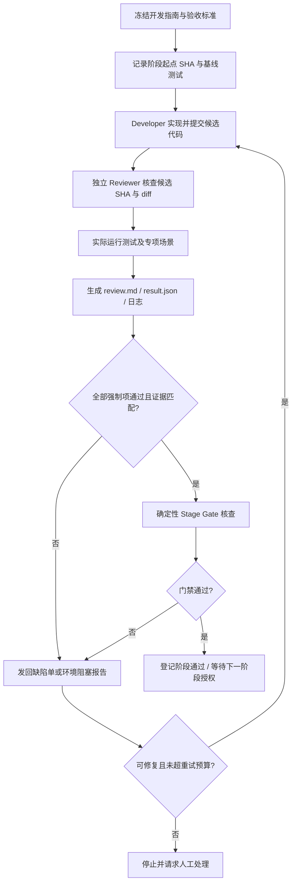
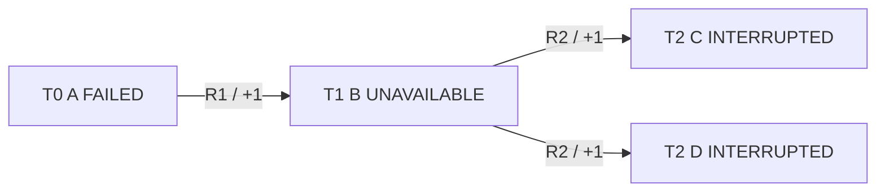

# GASS AI 独立验收指南

**版本：** V1.0（2026-11-25）  
**配套文件：**《GASS_AI开发实施指南.md》修订版 2（以下简称开发指南），建议分别保存为 `docs/development/ACCEPTANCE_PLAN.md` 与 `docs/development/DEVELOPMENT_PLAN.md`。  
**源码评审基线：** [czhcc/gass@1e11b598aebf3b5f59c7ee7713ec4c1c0591c1cf](https://github.com/czhcc/gass/commit/1e11b598aebf3b5f59c7ee7713ec4c1c0591c1cf)。实际验收必须使用本地阶段起点和待验收提交的完整 SHA，不以此评审基线替代。  
**适用对象：** 本地 Codex、Claude Code 或其他有源码读取、命令执行能力的编码智能体；可由同一模型的独立会话执行。  
**目的：** 为九阶段开发提供独立、可复核、可自动准入的验收规范。本文件不是已执行的测试报告；新增测试、脚本和示例均须在本地实现或验证，不表示仓库已具备相应能力。

## 1. 角色、权限与验收原则

| 角色 | 职责 | 权限边界 |
|---|---|---|
| Coordinator（调度 AI） | 确定阶段、冻结标准、提交验收请求、核查门禁、派发修复任务 | 不以自然语言报告替代门禁，不代替 Reviewer 签署通过 |
| Developer（开发 AI） | 按开发指南实现功能、补充测试、记录开发报告与提交 | 不修改已冻结的验收标准，不为通过验收削弱测试，不签署独立验收 |
| Reviewer（验收 AI） | 独立核对需求、架构、源码、测试、运行结果和兼容性 | 不修复候选业务代码，不修改候选提交，不代替用户批准范围变更 |
| 项目负责人（用户） | 批准阶段范围、验收标准变更、重大设计决策和风险例外 | 可明确调整后续计划，但不得把未经验证的结果标记为已通过 |

独立验收指独立会话、独立证据和角色分工，并不意味着必须使用不同模型。验收 AI 应先阅读原始需求和源码，之后再查阅开发报告；开发 AI 的自测报告只作为线索，不是通过依据。允许在隔离的临时目录编写独立测试和启动临时实例，但不得覆盖用户本地未提交修改，不得擅自创建 Git worktree（遵循 AGENTS.md），不得在 main 上修改源码或推送仓库。

六层验收均须覆盖：L1 需求覆盖；L2 架构与依赖；L3 实现正确性、安全、事务；L4 自动化测试；L5 业务场景；L6 兼容与回归。不是每阶段都需要真实浏览器测试，但对涉及 UI 的强制功能必须实际验证；仅组件测试不能冒充浏览器 E2E。

**硬性原则：** 测试通过不等于需求通过；引用有效不等于结论正确；Mock 验证不等于真实服务联调；代码阅读不等于运行验证；无法执行不等于通过。阶段 1 只验证行为保持和职责拆分，阶段 2–5 才逐步修复旧语义并引入世界演化/扩展。后续阶段不允许回退已通过的前置阶段行为。

## 2. 执行流程与阶段边界



### 2.1 验收前冻结输入

- 阅读 `AGENTS.md`、`docs/CODING_STANDARDS.md`、`DESIGN.md`、`README.md`、`docs/ARCHITECTURE.md`、`docs/DECLARATIVE_ACTIONS.md`、`docs/HIERARCHICAL_RUNTIME.md`、`docs/API.md`、`docs/ACCEPTANCE.md`、开发指南、本验收指南、`PROGRESS.md`。记录缺失文件，不自行编造内容。
- 明确 stage、阶段起点 SHA、candidate SHA、验收计划版本及摘要（SHA-256）、开发计划摘要、前置阶段验收记录。实际候选若落后于本地最新工作，不能把旧提交的结果套用到新代码。
- 在开发前批准本阶段的强制验收编号及适用条件。验收标准变更须由用户或其明确授权的管理流程批准并版本化；Reviewer 不得临时降低标准。
- 阶段 1–5 为核心建设，6–7 为闭环增强，8–9 可按用户决策延期。延期整阶段不等于通过该阶段；不得将本阶段的必做项自行标记为可选。
- 保存阶段开始时的 Git 状态、环境版本、已有失败、API 契约、迁移清单、典型运行结果。发现基线缺陷，记为 `BASELINE_DEFECT`，不得混入阶段 1 重构修复。若影响强制门禁，标记 FAILED/BLOCKED，独立修复或由用户批准调整计划后再验收，不把缺陷当作 PASS。

### 2.2 实际检查及测试执行

在项目根目录记录以下命令（Windows PowerShell 或 Bash 采用等价方式；不在用户工作区运行破坏性命令）：

```bash
git status --short
git branch --show-current
git rev-parse HEAD
git diff --stat <baselineSha> <candidateSha>
git diff --name-status <baselineSha> <candidateSha>
git diff <baselineSha> <candidateSha> -- backend frontend docs scripts
java -version
mvn -version
node --version
pnpm --version
```

使用本地锁定依赖和 README 指定的命令，通常为：

```bash
cd backend
mvn test
cd ../frontend
pnpm install --frozen-lockfile
pnpm test
pnpm build
```

若 `pnpm test` 是 watch 模式，使用项目实际支持的非交互式命令。执行 Maven 全 reactor；检查 Surefire/Failsafe（如有）报告、Vitest 报告、构建退出码，而非只看最后一行。若脚本存在 `scripts/smoke_mock.py`、`scripts/verify_p3.py`，先阅读其实际参数、前置条件和副作用，再按 README 在临时数据库/测试实例执行。不能凭空宣称运行脚本。

每次命令记录 command、cwd、开始/结束时间、退出码、测试数量、失败/跳过数量、日志路径与 SHA-256。使用进程真实退出码（注意管道 tee 不能掩盖退出码）。独立测试先记录 fixture 和预期，再运行候选实现；避免仅照抄 Developer 的测试。对测试 diff 检查 `@Disabled`、skip、only、条件屏蔽、断言删除、捕获异常后吞错、Mock 替代真实执行路径，以及依赖/测试插件的静默改动。

### 2.3 环境和测试安全

- 使用独立测试数据库和明确的临时数据目录、端口、Mock/本地协议 fixture；不得连接真实银行或对真实图谱执行写操作。不要重置实际运行的 GASS 数据库。
- 不提交凭证、SQLite 文件、模型密钥、构建产物或原始敏感日志。证据日志应脱敏，不能为了验证越权而导出真实敏感信息。
- 模型契约使用 `mock://local` 或本地 OpenAI 协议 fixture，记录真实 SDK 是否被调用。若执行外部 LLM / MCP 联调，必须有批准的只读配置和资源预算；缺少配置按条件项说明，不编造通过。
- 运行真实测试有网络、依赖或权限阻塞时记录 BLOCKED、具体错误及重试条件。Reviewer 不擅自修改环境全局配置。

### 2.4 建议证据目录与测试方法

```text
docs/development/
├── DEVELOPMENT_PLAN.md
├── ACCEPTANCE_PLAN.md
├── ORCHESTRATION.md              # 可后续编写
├── PROGRESS.md
├── REFACTOR_MAP.md               # 阶段1
└── acceptance/
    └── stage-01/
        ├── baseline.md
        ├── development.md
        ├── attempt-01/
        │   ├── review.md
        │   ├── result.json
        │   └── evidence-index.json
        └── attempt-02/           # 修复后保留前次记录
```

体积大的日志、截图、测试 XML 放在仓库外或已忽略的验收产物目录，使用证据索引关联，不必将原始产物提交 Git。可选引入 ArchUnit 保护包边界、Playwright 做浏览器 E2E；若未具备工具，先用可复现的静态依赖分析或真实浏览器测试方案，不将工具名本身当作验收目标。新增正式测试依赖应遵循开发阶段范围及用户授权。

## 3. 通用强制验收矩阵（所有实际实施阶段）

编号贯穿计划、报告和门禁。表中“证据”是最低要求；需要动态测试的项不可仅凭源码判断通过。各阶段追加专项编号；已通过阶段相关行为应纳入回归。尚未建设的未来能力不提前验收。

| 编号 | 验收项 | 方法与通过标准 | 最低证据 |
|---|---|---|---|
| G-01 | 输入一致 | 完整 SHA、阶段、冻结计划和前置阶段记录一致；无未纳入候选的业务修改 | Git 输出、计划哈希 |
| G-02 | 需求与范围 | 每项需求映射实现和测试；无提前实施后续阶段或未批准偏差 | 追踪矩阵、diff |
| G-03 | 架构与技术栈 | 保持 JDK21/Spring Boot4/Maven、AgentScope、CEL、SQLite/Flyway、Vue3 等锁定技术；模块 `bootstart → app → common`；无未经批准新框架及循环依赖 | POM/依赖检查、源码 |
| G-04 | 测试完整性 | 原有断言不被削弱；新增测试验证负例、边界与实际业务效果 | 测试 diff、报告 |
| G-05 | 后端测试 | 全量 Maven 测试实际退出 0；无未经批准失败、跳过或未运行强制套件 | 命令日志、XML |
| G-06 | 前端测试及构建 | pnpm 全量测试及生产构建退出 0，保留既有页面行为 | 命令日志、报告 |
| G-07 | 数据兼容 | 已执行 Flyway 不修改；空库、旧库升级与历史运行读取通过；阶段1不新增迁移 | 迁移 diff、集成测试 |
| G-08 | API 兼容 | 旧请求、响应、错误码、冻结 JSON、事件读取保持兼容或明确批准兼容扩展 | 契约测试、API diff |
| G-09 | 权限与安全 | 模型无直接 DB/任意脚本/真实写接口；读、Action、系统执行权限独立；日志无密钥 | 静态审查、越权测试 |
| G-10 | 状态一致 | 原子提交、拒绝不改状态、版本冲突及幂等；回放无副作用 | 集成测试、状态/事件对比 |
| G-11 | 现有业务回归 | 银行与信息场景、人工干预、停止恢复、分支、目标报告和 SSE 保持应有行为 | 固定 fixture、测试输出 |
| G-12 | 工程规范 | 注释、@author、命名、SQL、双语、错误反馈符合 AGENTS.md 和编码规范 | diff、UI 检查 |
| G-13 | 交付与可追溯 | 文档、变更、限制、回滚点、测试和候选 SHA 一致；无敏感或生成文件提交 | 文档、git 状态、证据索引 |

## 4. 阶段 1：代码结构调整与职责拆分（P0）

**开发指南对应：** 阶段1/第4–6节。目标是行为保持型重构，不是功能修复。重点是新版 `RunService`、`HierarchicalCoordinator`、`ObjectiveEvidence`、`GraphQueries`、`RunGraphReadService` 等。先运行基线，再以同一 fixture 在候选版本执行；若需对比两个提交，应使用已有隔离 checkout 或经批准的临时副本，禁止覆盖工作区。

| 编号 | 操作与检查 | 必须满足的预期 |
|---|---|---|
| S1-01 | 对照 REFACTOR_MAP.md、旧/新包及依赖图 | graph、evidence 等形成实质职责边界；模块方向不变；无循环依赖；不只移动大类或新增空壳服务 |
| S1-02 | 检查 RunService 调用链和抽取前后职责 | 生命周期保留，持久化、调度、提交、预算、RuntimeHost、终止策略有效拆分；命名可不同但职责不重新堆积 |
| S1-03 | 检查 HierarchicalCoordinator 及工具、上下文、证据、目标完成和最终研判 | 协调器以编排为主，SDK 工厂/委派/证据投影等有清晰边界；每次 invocation 的状态不跨运行共享 |
| S1-04 | 启动 Spring 应用，执行 Controller、Service、配置加载测试 | Bean 扫描、依赖注入、序列化、公开 API 与现有配置正常 |
| S1-05 | 比较 V1–V9（或本地已有最高版本）及数据库结构、REST/JSON 契约、依赖变化 | 不新增/修改迁移，不修改业务语义、协议、模型工具名和参数；不引入 ECA/KG/新模式 |
| S1-06 | 双调用同版本、暂停/取消/恢复、提交失败、事务与锁审查 | 原共享锁、lease、取消、版本检查和事务边界等价；不因拆分各自 synchronized 而破坏并发；LLM 不在写事务中 |
| S1-07 | 运行银行、信息领域同输入基线 | 余额、状态、裁定、收据、事件类型和语义顺序、业务目标一致 |
| S1-08 | 执行冻结 Action、历史回放、Fork、历史记录读取 | 既有快照、分支时钟与旧事件兼容；回放不执行 LLM 或 Action |
| S1-09 | 文字目标为纯图谱查询，混入无关默认角色目标或告警 | 仍按保存的 objective，QUERY 不错误调用修改类 Action |
| S1-10 | 路径排名 fixture：启用有向边、环、两个并列最优，限制深度/返回条数 | 路径不重复对象；类型计数、并列结果及 complete/tiesTruncated 与基线一致；保留64跳及50000路径前缀预算 |
| S1-11 | 同 run/version/精确 scope/规范化参数重复查询，再变更 run、分支、scope、版本 | 保持缓存命中与隔离，审计 reused 标记不丢；不把缓存命中当作免审计 |
| S1-12 | 跨轮查询复用，随后执行改变图谱版本的 Action | 新版 current-version 证据复用保持；旧查询不作为当前版本证据 |
| S1-13 | 有效引用 complete_objective、非法/过期/越权引用、有 CEL 条件场景 | 旧提前完成、关闭委派、horizon、NO_CONDITIONS、OBJECTIVE_REVIEW_COMPLETED 与基线一致；已知旧缺陷记录，不在本阶段修复 |
| S1-14 | 模拟接收信息后禁用相关关系，查看历史 Action 与最终图谱 | history 和 finalState 分开；历史行为不被最终状态覆盖；HierarchyHost.record 返回实际持久化序号 |
| S1-15 | 旧 ObjectiveReview JSON、新报告、引用跳转、播放、SSE 去重与原文展开 | 可读化只改显示不改原始证据；旧报告兼容；回放位置准确 |
| S1-16 | 检查源码/文档 diff、测试报告与重构映射 | 有可追溯的小步重构、实际职责说明和风险清单；无未批准后续功能或全仓无关格式化 |

**测试入口参考：** `ObjectiveGraphQueryTest`、`HierarchyModelContractTest`、`HierarchicalFrameworkIntegrationTest`、`HierarchyGatewayIntegrationTest`、`DeclarativeActionEngineTest`、`ObjectActionRuntimeIntegrationTest`、`SimulationIntegrationTest`、`ContinuationIntegrationTest`、`RunTerminationIntegrationTest`、`ActionLibraryIntegrationTest`；前端 `RunStudio.test.ts`、`HierarchyTrace.test.ts`、`EventDetails.test.ts`、`ObjectActions.test.ts`。以实际本地名称为准。

**基线比对方法：** 对照 REST payload、状态实体/关系、金额、裁定码、事件类型及相对顺序、报告字段、权限结果。仅规范化确知无业务含义的随机 ID、真实耗时、墙钟时间；对 ID 引用关系做一致映射，禁止忽略整个事件、金额、逻辑时间或失败码。SDK fixture 比较请求工具 schema、调用顺序和授权范围，不要求真实 LLM 文本逐字相同。

**禁止混入：** 旧时间公式、证据相邻序号关联、旧权限语义、未来时点判定等缺陷归入阶段2/3/4；不通过改变行为制造“更好”的回归结果。

## 5. 阶段 2：形式化本体、Action 与统一状态提交（P0）

**开发指南对应：** 第7节。保护已有 CEL/Action 库和冻结契约，建立状态变更、可见性和证据关联基础。阶段2不启动 ECA，不做外部导入。

| 编号 | 独立测试或审查 | 预期 |
|---|---|---|
| S2-01 | 加载旧本体、已发布 Action 和旧运行，创建/回放/Fork | 老契约兼容，历史发布定义不被重写；新增严格验证仅按契约生效 |
| S2-02 | 严格类型中写入字符串到整数属性、缺必填、非法枚举/区间、不可变属性、未知属性 | 按定义拒绝，保留原状态和正确错误码；旧本体兼容模式有记录 |
| S2-03 | 构造非法关系端点、悬空边、重复 ID/超基数、非法金融值 | 本体/领域校验拒绝，不产生不合法对象或关系 |
| S2-04 | 调用已有三原语及本阶段实际新增原语；试图用通用原语修改受保护余额/币种/交易 | 合法执行不退化，绕过金融不变量失败；新增原语有白名单，不支持任意脚本 |
| S2-05 | 多步骤 Action：前一步成功、末步失败或不变量失败 | 整笔回滚；无成功收据、无已提交快照、无有效变化事件 |
| S2-06 | 多步 Action 修改属性后又恢复原值；比较缺失/null 与数值表示 | diff 基于最终候选，no-op 不增图谱版本；实际变化准确记录，只增一次版本 |
| S2-07 | 同版本双请求、相同 commandId 重试、同键不同参数 | 只允许合法提交，重试返回同收据，冲突拒绝；无重复转账 |
| S2-08 | 注入持久化故障（状态/快照/收据/日志写入期间） | 同一事务回滚；失败无部分提交，恢复后状态可验证 |
| S2-09 | 对受限 Worker 比较查询、能力列表、Action 及证据引用；尝试越过委派范围 | 统一有效可见范围；只读不等于可写；跨对象参数和回执不泄露 |
| S2-10 | 不同 run/version/scope 查询缓存；模拟权限或覆盖版本变化 | 查询先授权，缓存使用不可变投影，正确隔离；每次查询仍有审计 |
| S2-11 | 旧记录缺 scopeIds，局部与全范围角色分别引用 | 局部角色无法以未知范围事件绕过授权；可靠历史重建或全范围才可使用 |
| S2-12 | 在新 Action 提议、裁定、状态变化之间插入其他审计事件 | actionRunId 关联正确，不依赖 sequence±1；旧事件可兼容读取 |
| S2-13 | 检查 origin、actor、input/outputVersion、commandId 和证据标记 | 用户、智能体、初始化等来源清楚；不把 SIMULATED 当执行身份；回放无写入 |
| S2-14 | 搜索完整但并列返回截断、局部授权、旧查询、历史 Action | 分开表达算法完整性、返回截断、范围和时间；文字目标不被错误提升为自动业务成功 |

证据：本体/原语测试、事务故障测试、权限负例、状态和事件 JSON、旧库迁移验证。若某新增原语在开发指南中明确为可延期，记录适用条件与批准，不强制实现；一旦开放必须通过对应负例。

## 6. 阶段 3：模拟时钟与持久化事件调度（P0）

**开发指南对应：** 第8节。轮次、逻辑时间、图谱版本、审计序号独立；旧轮次模式兼容；新模式由队列推进，不能把任务完成等同运行终止。

| 编号 | 独立测试 | 预期 |
|---|---|---|
| S3-01 | 在 T=5 安排15个事件，预算允许全部处理 | 全部在 T=5 执行，不因每批10个而延迟；预算不足则显式停止/暂停并保留待处理项 |
| S3-02 | T=2、T=100 两事件，中间无事件；注入模型/网络等待 | 时钟直接跳转，空闲不产生空轮次；墙钟等待不影响逻辑时间 |
| S3-03 | 同时刻不同 priority 和 enqueueSequence 的事件，重复运行 | 按冻结排序规则稳定执行，非随机 UUID 决定顺序；时间单调 |
| S3-04 | 暂停、恢复、取消、处理中断，检查 lease 和工作项状态 | 不越过暂停/取消继续提交；恢复合法，失败原因可查 |
| S3-05 | 在领取工作项后、提交前后分别模拟进程异常/事务失败，再启动 | 持久化恢复无丢失或重复业务效果；幂等键与工作项完成态一致 |
| S3-06 | 无业务状态变化的时钟推进；在不同 sequence Fork | 时间准确回放；同 stateVersion 可对应不同时间；分支继承当时 pending，不继承未来入队 |
| S3-07 | 旧场景、旧 EVENT_DRIVEN 名称及旧注入/绑定行为 | 兼容模式不静默改语义；已交付运行仍可读、继续或按文档限制处理 |
| S3-08 | 无 CEL 条件且允许提前完成的纯文字查询 | 仍可提前结束，NO_CONDITIONS 不等于 OBJECTIVE_MET |
| S3-09 | 冻结 earliestRound/earliestSimulationTime，提前调用 complete_objective | 程序门禁拒绝提前终止；时点满足后按配置处理，不只靠提示词 |
| S3-10 | 文字目标已回答但队列有未处理输入、在途项或待处理事件 | 相关事件按冻结策略继续；不能仅依据 delivered 标志或目标完成停止 |
| S3-11 | horizon 到达但尚有未来事件；空队列但 horizon 未到 | 区分 HORIZON_REACHED 与 QUIESCENT；未处理事件有明确记录，不静默丢弃 |
| S3-12 | 目标回答后世界改变版本；最终研判服务失败 | 当前证据重新验证；历史回答保留；引擎判定仍持久化、失败报告不冒充成功 |
| S3-13 | 分别触发预算限制、取消、自然完成、目标条件不满足和表达式异常 | 运行终止原因、目标状态、队列状态可区分；无虚假成功 |

证据：带 dueTime/实际 simulationTime/sequence 的事件轨迹、事务和恢复测试、冻结策略 fixture；禁止用 sleep 代替逻辑时间验证。

## 7. 阶段 4：ECA 自主传播（P0）

**开发指南对应：** 第9节。验证规则为独立确定性组件，状态变化提交后通过持久化队列产生衍生 Action，而不是 Action 递归调用 Action。首版不要求 REQUEST_AGENT（阶段6）。

### 7.1 固定验收世界（由 Reviewer 独立构造）

四个对象：DEVICE A.status=NORMAL；SYSTEM B.status=AVAILABLE，hasBackup=false；PROCESS C、D.status=RUNNING。启用边 `B DEPENDS_ON A`、`C DEPENDS_ON B`、`D DEPENDS_ON B`；另建不相干对象 E，保持正常。冻结规则 R1：A 的 status 从非 FAILED 变为 FAILED，且 B 无备份，延迟1调用 B 的 MARK_UNAVAILABLE；R2：B 状态变为 UNAVAILABLE，延迟1调用 C、D 的 INTERRUPT_PROCESS。规则匹配的关系方向与备份条件必须明确。初始时刻 T=0，人工执行 FAIL_DEVICE；无真实 LLM、无外部 KG。C/D 同时刻顺序按已冻结排序规则确定。



这是测试假设，不是现实故障预测模型。记录每次 Action 收据、状态版本、逻辑时间、rule revision、causeEventRef 和关联任务。独立复算预期，不根据程序输出倒推预期。

| 编号 | 操作与检查 | 预期 |
|---|---|---|
| S4-01 | 执行上述 fixture；关闭或以失败探针替换所有 LLM 调用 | A→B→C/D 自动演化；E 不变；模型调用计数0；3个衍生 Action，时间正确，来源为 SYSTEM_RULE |
| S4-02 | B.hasBackup=true；禁用依赖边或关闭规则 | 不产生相应影响；明确备份/关系/规则条件，不把任意图边当作因果 |
| S4-03 | Action no-op、候选状态失败、关系无实际变化 | 不产生有效状态变化或衍生工作；拒绝收据可追溯 |
| S4-04 | 规则配置非法 CEL、未知目标类型/Action、负延迟、非法参数 | 校验或执行安全拒绝，试算不提交，失败不破坏状态 |
| S4-05 | 规则执行身份越权、目标 Action 未绑定或参数不合法 | 仍经统一 Action 权限、领域约束、预算与参数检查；无越权读写 |
| S4-06 | 延迟 Action 排队后改变目标状态/前置条件 | 到期按当前状态重新校验；拒绝有日志，已成功父 Action 不隐式回滚 |
| S4-07 | 重投同一事件、同一 rule revision 及目标参数 | 幂等去重；不重复派生；合法不同事件仍可再次执行 |
| S4-08 | 构造 A→B→A 零延迟振荡和超 fan-out | 因果深度/同时刻/总预算明确停止；无栈溢出或无限队列；不把合法有界周期误判为同一事件重投 |
| S4-09 | 模拟规则消费与派生入队事务失败，重启 | 无漏发/双发；父事件、派生工作及状态一致 |
| S4-10 | 初始化已有 FAILED 属性、回放、EXTERNAL_IMPORT 来源（阶段5完成后用真实导入回归） | 默认不触发业务传播；阶段4可用来源 fixture 验证过滤 |
| S4-11 | 修改草稿或发布新规则；旧运行、历史 Fork、父子分支各自执行 | 冻结规则版本不变；父子队列及世界隔离；历史读取不重新触发 |
| S4-12 | 对文字目标提前完成后保留的规则链执行到终止 | 待处理衍生事件不被丢弃；正确区分任务完成、规则失败、horizon 和自然结束 |
| S4-13 | 根据任一衍生事件反向定位初始 Action、规则版本和前后状态 | 显式因果引用完整，插入无关事件不影响关联；作用仅为模型内部因果，不冒充真实事实 |
| S4-14 | 规则草稿/校验/启用、场景绑定、预览及旧场景运行 | 最低管理功能可用；规则无配置默认不改变旧场景；未知事件在 UI/SSE 安全展示 |

## 8. 阶段 5：外部知识图谱按需世界扩展（P0）

**开发指南对应：** 第10节。只读 Provider 与模拟世界导入分离。先用 Mock Provider 做全部确定性验收；真实 MCP 无配置时使用本地协议 fixture 检查 adapter/白名单/异常，不宣称真实业务联调完成。

### 8.1 固定验收数据

初始 A（CNY余额10000分）及本地 B（CNY余额0分），外部身份显式映射 A；执行模拟转账2000分到 B，A=8000、B=2000。外部源仍返回 A=10000，另含 C=5000分、合法关系 A→C，以及一条在模拟中已禁用的既有关系。导入后 A=8000、B=2000、C=5000，合计15000；`importDelta=5000`、内部模拟转账净变化为0。构造不同币种、未知类型、越权对象、截断结果及网络失败的独立变体。数字仅为测试 fixture。

| 编号 | 独立测试 | 预期 |
|---|---|---|
| S5-01 | external search/expand 仅查询；检查图谱前后版本与事件 | 只读候选不改变图谱；明确 queryScope、completeness、truncated、hasMore |
| S5-02 | 导入合法候选及其关联子图 | 对象和关系端点合法，状态/身份映射/来源/动态授权/快照原子提交；实质变化增版本，不推进模拟时间 |
| S5-03 | 重复导入，同名不同外部ID、不同 provider 同ID | 不重复创建；不以同名误合并；来源身份隔离；无图谱差异不增图谱版本 |
| S5-04 | 执行固定转账 fixture 再导入旧余额与缺失属性 | 保留8000分及已有模拟字段；仅补缺；不得覆盖已有合法字段 |
| S5-05 | 重新导入已禁用关系和删除 tombstone（若支持删除） | 不错误恢复边或对象；显式报告冲突 |
| S5-06 | 未映射类型、单位转换错误、非法属性、悬空边、部分提交故障 | 拒绝或返回待映射；不自动创建本体/Action；整批原子处理，无部分状态 |
| S5-07 | 候选 ID 伪造、跨 run/分支/授权使用、过期、载荷篡改 | 服务器绑定真实查询批次并验证，拒绝且不泄露内容 |
| S5-08 | 模型尝试任意 MCP 工具、写接口、任意 URL/重定向、超大响应 | 工具及网络白名单、超时、大小、认证边界有效；只读无外部写；凭证不入日志 |
| S5-09 | 外部调用超时、断网、返回时状态版本变化或运行取消 | 无长时间 SQLite 写事务/运行锁；提交前重新验证 lease、版本、权限和预算；失败不改状态 |
| S5-10 | 触发深度、每批/总对象数、关系数、调用次数、审批要求 | 超限/未审批拒绝或按明确截断协议处理；不能突破服务器上限 |
| S5-11 | QUERY Worker 导入新对象；另一角色无读权限，第三角色可读但无 Action 权限 | 可见授权按范围发放；查询、能力、执行和证据一致；不隐式授权所有 Worker |
| S5-12 | 导入已有故障设备（status=FAILED） | 标为 EXTERNAL_IMPORT，默认不触发新的故障事件；数据补充通知与业务事件区分 |
| S5-13 | 导入前后分别 Fork，断开外部 Provider 并回放 | 回放无外部查询；只继承分支点已有数据、来源、动态授权；父子隔离 |
| S5-14 | 导入后重复本地图谱查询；权限/coverage 单独变更 | 图谱版本、有效范围或权限/覆盖 revision 隔离缓存；当前证据失效后重新验证；每次查询审计完整 |
| S5-15 | 对部分外部子图做完整本地路径排名；查询被拒绝与真正无结果分别测试 | 局部 complete 不冒充全图最优；未知、部分、无结果有不同语义及限制 |
| S5-16 | 固定余额 fixture 及不同币种分组 | 15000分总额正确，导入5000分不误判资金不守恒；按币种聚合；不同数据基线不可直接比较 |
| S5-17 | 检查外部对象/属性/关系的 provider、externalId、sourceVersion/as-of、查询批次、导入时间及版本 | 来源证据可追溯，字段模拟写入与外部事实区分；权限投影和最小保留有效 |
| S5-18 | Mock Provider 与真实 MCP adapter 的本地协议契约测试 | 实际请求映射、只读工具白名单、错误处理通过；真实业务源联调按下述条件项报告 |

**条件项 S5-C01：** 已有经批准的真实只读 MCP 配置时，执行一次受控搜索/扩展与导入，验证映射、证据及无外部写请求；未配置且本次冻结范围只要求 Mock + adapter 契约时标为 NOT_APPLICABLE，附原因；已配置且要求实际联调但无法连接则 BLOCKED。不能用 Mock 冒充真实联调。

## 9. 阶段 6：事件驱动任务智能体与推演工作台（P1）

**开发指南对应：** 第11节。保持 Master/QUERY/ACTION 任务智能体；REQUEST_AGENT 只生成研判工作项，不让 Rule Engine 成为智能体。对 UI 采用组件测试和实际浏览器 E2E；若浏览器无法启动，明确记录相关项 BLOCKED。

| 编号 | 独立测试 | 预期 |
|---|---|---|
| S6-01 | 规则发出 REQUEST_AGENT，模拟正常研判响应 | 事件调度器持久化请求，Master 统一委派；不由规则直接启动任意 Agent 或调用 LLM |
| S6-02 | 同一事件重复请求、同合并键连续事件、超预算、暂停/取消 | 去重、合并规则可核查；预算及 lease 生效；不在 SQLite 写事务内等待模型 |
| S6-03 | 研判读取后改变世界版本，提交旧 expectedVersion | 拒绝过期行动，重新读取/规划；任务授权不扩大 |
| S6-04 | 运行设备传播 fixture，打开时间线及事件详情 | AGENT/USER/RULE/EXTERNAL_IMPORT 来源明确；模拟时间、轮次、状态版本、队列数与后端一致 |
| S6-05 | 从衍生行动点击父事件、rule revision、对象及 Action 回执 | 完整因果链定位，范围及深度受限，非法 runId/sequence 不越权；不展示私有推理过程 |
| S6-06 | 导入外部对象、修改其属性及关系，查看图谱和详情 | 来源及模拟变更清晰，有标签/文本而非仅靠颜色；冲突和未知来源有提示 |
| S6-07 | 通过界面配置属性约束、规则启用、导入预览与确认（按实际功能） | 表单校验、拒绝原因和重复提交保护有效；未授权操作不暴露可用入口 |
| S6-08 | SSE 中途断连、按 Last-Event-ID/after 恢复、重复/乱序记录 | 去重排序无丢失；运行/权限范围隔离；关闭连接无残留轮询 |
| S6-09 | 单步事件、整轮研判、暂停、人工干预、历史拖动及 Fork | 控制与播放区分；回放不执行 Action、LLM 或外部查询；界面与状态快照一致 |
| S6-10 | 提前完成、最终研判失败、旧报告及新规则/导入报告 | 引擎结果保留；history/finalState、来源、实际评价时点及证据跳转正确；不把未验证陈述当事实 |
| S6-11 | 中英文切换、空数据、未知事件、错误、权限隐藏、键盘操作 | 符合 DESIGN.md 和编码规范，无页面崩溃；表单标签和焦点反馈有效 |

建议真实浏览器脚本：启动测试实例 → 登录 → 创建世界及场景 → 设置规则 → 运行 → 检查事件与图谱 → 暂停/干预 → 回放 → 分支 → 比较 → 断线重连。使用测试数据库和可重复 fixture，保存关键步骤的断言、截图与浏览器错误日志，截图不能代替断言。

## 10. 阶段 7：业务指标与实验评价（P1）

**开发指南对应：** 第12节。先验收确定性评价和可比性，再根据冻结范围实施可选批量实验。不得用模型文字决定业务成功。

| 编号 | 独立测试 | 预期 |
|---|---|---|
| S7-01 | CEL 条件全部满足、部分不满足、非法表达式、空条件 | 分别输出 SUCCEEDED/FAILED/ERROR/NO_CONDITIONS 或兼容等价码；与运行状态、文字回答分开 |
| S7-02 | 两个同币种账户与一个不同币种账户；独立复算余额与守恒 | 按币种分组，不将异币种金额或风险评分直接相加 |
| S7-03 | 固定数据测试 COUNT/SUM/AVG/MAX/RATIO，缺值与零分母 | 指标、单位、聚合及缺失策略与定义一致；不把未知当0；非法表达式有错误 |
| S7-04 | 使用阶段5固定导入 fixture，并追加合法 Action | importDelta/actionDelta 分开，守恒与范围扩展独立；潜在关联不计为实际模拟影响 |
| S7-05 | 同冻结基线，设备有备用与无备用两个干预分支 | 可独立复算直接/衍生影响及差异；报告注明模型假设与评价范围 |
| S7-06 | 两分支引入不同外部数据或冻结规则版本不一致 | 明确不可比或要求统一基线；不输出无依据干预改善百分比 |
| S7-07 | 终止于预算、horizon、队列静止、未完成目标等情形 | 指标报告说明终止原因、未处理事件、评价时点和覆盖限制 |
| S7-08 | 相同冻结输入及已记录行动序列执行两次；离线回放 | 确定性机制结果一致；回放不调用 LLM/外部源；真实 LLM 重新运行不承诺复现 |
| S7-09 | 修改目标条件、指标定义或模型配置后查看旧运行 | 冻结定义与来源正确，原评价/证据不被新配置覆盖 |

**可选实验子范围（开发前明确是否纳入）：**

| 编号 | 独立测试 | 预期 |
|---|---|---|
| S7-C01 | 固定种子策略，基线/干预各运行多次 | 每次关联冻结世界、Action/规则/策略/模型版本、种子、决策及停止原因；确定性策略可重现 |
| S7-C02 | 使用已知样本如 [2,4,6] 验证汇总；另含失败/中断样本 | n=3、均值4；按定义报告分布和失败比例；不丢弃失败样本或误当成功样本 |
| S7-C03 | 超实验次数、模型请求、时间预算；暂停/取消 | 资源受控，实验记录完整；不擅自调用真实模型消耗资源 |
| S7-C04 | 改变一个领域参数并比较结果 | 敏感性结果有参数依据；区分程序验证、业务模型确认与真实数据校准；无校准不得声称现实预测准确 |

## 11. 阶段 8：显式任务规划（P2，可延期）

**开发指南对应：** 第13节。仅在明确启动该阶段后验收；保留原 ReAct 动态委派。轻量任务 DAG 不宣称已实现严格 HTN 搜索算法。

| 编号 | 独立测试 | 预期 |
|---|---|---|
| S8-01 | A、B 无依赖，C 依赖 A 和 B，提交结构化 Plan | 按依赖及冻结执行策略调度，C 仅在前置任务满足后开始 |
| S8-02 | 环、自依赖、重复任务ID、缺失依赖、非法角色 | 提交前拒绝，不启动任何非法任务 |
| S8-03 | Plan 包含越权 scope、Action、工具或超预算 | 程序校验拒绝，不因计划由 Master 生成而扩大权限 |
| S8-04 | 前置任务失败/取消、CEL 完成条件为 false | 按显式失败策略处理，不将任务报告文本当通过 |
| S8-05 | 执行中状态版本变化使原计划不可行 | 刷新状态后受控重规划，保留旧计划与替换关系，限制次数 |
| S8-06 | 计划任务依赖与世界延迟事件并存 | PlanExecutor 不替代模拟时钟；不绕过 ECA/终止/版本控制 |
| S8-07 | 禁用 Plan，执行已有文字目标与 ECA 场景 | 旧模式不退化；计划、任务、收据与证据可回放 |

## 12. 阶段 9：模拟智能体（P2，可选）

**开发指南对应：** 第14节。模拟智能体是世界对象的行为代理，非 Master 的从智能体；Rule Engine 保持确定性组件。只在明确有自主行为需求时启动本阶段。

| 编号 | 独立测试 | 预期 |
|---|---|---|
| S9-01 | 两个对象具有不同自身目标及局部观察，绑定同一可配置策略 | 分别选择符合自身配置的行动；不由 Master 逐一代替决策 |
| S9-02 | 向对象隐藏其他实体/关系，尝试通过策略访问 | 只获得授权局部观测；不得读取完整图谱或执行未绑定 Action |
| S9-03 | 事件/时钟唤醒对象；分别使用规则型、数学型及冻结种子概率型策略 | 调度与模拟时间一致；非 LLM 策略可无模型运行；固定种子与输入可重复 |
| S9-04 | 模拟智能体行动引发 ECA，再由其他对象观察并行动 | 共享对象 Action、事务、状态变化事件及因果链；执行身份正确 |
| S9-05 | 多对象同时操作同一状态；越权/前置条件失败 | 正确排序、版本检查与授权；无负余额等非法状态 |
| S9-06 | 对大量对象共享策略，触发次数/时刻/调用预算 | 不无条件创建大量 ReActAgent；资源有界，预算停止可查 |
| S9-07 | 回放、Fork 及修改行为定义；旧运行继续 | 冻结策略和对象行为状态可追溯，分支隔离；回放不重新决策 |
| S9-08 | 不绑定模拟智能体，运行现有银行、信息、ECA、世界扩展场景 | 核心系统可独立工作，不新增强制 BDI 或其他运行依赖 |

LLM 行为策略、完整 BDI 认知模型仅在明确纳入冻结范围时追加验收。若实现 LLM 策略，还需验证局部权限、结构化 Action、请求预算、取消和证据来源；不能声称随机种子保证 LLM 输出一致。

## 13. 跨阶段最终端到端验收

核心阶段 1–5 完成后运行 A–H、J–M 中已实现部分；阶段6–7完成后执行全部适用项目。阶段1先执行 A、K 的基线对比；阶段2开始保护 M，阶段3开始保护 L，后续逐步累积。不能只通过孤立单元测试宣布整个平台完成。

| 编号 | 场景 | 核心断言 | 对应开发指南 Demo |
|---|---|---|---|
| E2E-A | 原银行/信息场景 | 既有收据、状态、目标及回放无退化 | A |
| E2E-B | 设备故障自动传播 | 无 LLM、逻辑时间正确、因果链完整 | B |
| E2E-C | 同基线干预分支 | 干预效果可复算、未混入范围变化 | C |
| E2E-D | 外部扩展再合法转账 | 数据来源、同币种守恒、无外部写 | D |
| E2E-E | 重导入已修改对象和禁用边 | 状态不覆盖、关系不复活、对象不重复 | E |
| E2E-F | 同时到期、循环、重投和故障 | 顺序、去重、恢复、预算均有效 | F |
| E2E-G | 在事件及导入前后 Fork | 正确继承时钟、状态、队列、授权；无未来信息 | G |
| E2E-H | 恶意候选、模型越权、规则越权 | 拒绝，无未授权读写和凭证泄露 | H |
| E2E-I | 工作台完整流程 | SSE、干预、回放、对比、证据跳转 | I |
| E2E-J | 多币种、导入与不完整数据 | 指标准确，范围不同时明确不可比 | J |
| E2E-K | 文字目标与路径排名 | 缓存隔离、提前完成、历史和最终状态区分 | K |
| E2E-L | 文字完成但尚有相关事件 | 冻结终止策略生效，NO_CONDITIONS 不冒充成功 | L |
| E2E-M | 显式事件关联与历史回放 | actionRunId、causeEventRef 定位准确；旧事件兼容 | M |

## 14. 问题分类、结论与报告

### 14.1 问题等级

| 等级 | 定义 | 示例 | 门禁 |
|---|---|---|---|
| BLOCKER | 安全、核心架构、业务不变量、严重兼容性或数据一致性问题 | 模拟结果写回真实 KG；转账重复扣款；历史数据破坏 | 必须关闭 |
| MAJOR | 阶段必要功能缺失或行为错误 | RunService 未实质拆分；ECA 需 LLM；提前结束丢事件 | 必须关闭 |
| MINOR | 非强制细节问题，核心功能和验收项不受影响 | 局部文档或非关键可读性优化 | 可记录后续处理；若违反强制项仍阻塞 |
| SUGGESTION | 非强制优化或未来扩展 | 性能进一步优化、可选工具 | 不阻塞 |

每个缺陷单必须含 id、stage、checkId、severity、候选 SHA、文件/方法/行号、复现前提与命令、输入、预期、实际、证据路径、影响、修复建议、状态、是否基线已有。修复关闭必须由 Reviewer 对新提交重新验证，不由 Developer 自报关闭。

### 14.2 检查及阶段状态

单项检查允许 `PASSED` / `FAILED` / `BLOCKED` / `NOT_APPLICABLE` / `NOT_RUN`。NOT_APPLICABLE 仅用于开发前批准的条件项，需依据和批准记录；强制项不能标 N/A。阶段状态：

- `PASSED`：所有适用强制项均 PASSED，必要命令退出0、证据完整、无 OPEN BLOCKER/MAJOR，前置阶段及冻结计划匹配，独立验收完成。
- `FAILED`：发现明确不符合项或未关闭重大缺陷。
- `BLOCKED`：无已知失败但至少一项强制验收因环境/权限/依赖/输入缺失无法完成；同时存在失败时阶段标 FAILED 并列出阻塞。
- `NOT_STARTED`：尚未开始验收；`DEFERRED`：用户明确延期整个可选阶段，不能解释为 PASSED。

`nextStageAllowed` 不是 AI 主观判定字段，应由门禁根据实际结果计算。阶段未通过不得开始后续依赖开发。未获下一阶段授权不得自动实施（用户可在独立调度规范中授权连续执行）。

### 14.3 review.md 模板

```markdown
# GASS 阶段 N 独立验收报告（第 X 次）

- 阶段及冻结范围：
- 验收计划版本 / SHA-256：
- 开发计划版本 / SHA-256：
- 阶段基线 SHA：
- 候选完整 SHA：
- 前置阶段验收记录：
- 验收者 / 会话标识 / 时间 / 环境：
- 工作区状态与限制：

## 1. 总体结论
PASSED / FAILED / BLOCKED，依据及适用边界。

## 2. 需求—实现—测试追踪矩阵
| Check ID | 需求章节 | 代码路径/方法 | 测试/命令 | 预期 | 实际 | 证据 | 状态 |
|---|---|---|---|---|---|---|---|

## 3. 架构、安全、事务和兼容性审查
列出可复核证据；区分静态检查与实际运行。

## 4. 测试执行结果
| 命令/CWD | 退出码 | 总数/失败/跳过 | 日志/报告 | 备注 |
|---|---|---|---|---|

## 5. 业务场景、历史数据及回归
记录输入、预期、实际、快照/事件序号、测试截图（如适用）。

## 6. 问题与修复任务
| ID | Check ID | 等级 | 路径/方法 | 复现及影响 | 修复建议 | 状态 |
|---|---|---|---|---|---|---|

## 7. 未验证范围与设计偏差
列明 BLOCKED、条件项 N/A、真实联调限制及批准记录。

## 8. 阶段准入建议
仅在所有强制项具备证据时建议准入；最终以 Stage Gate 实际结果为准。
```

### 14.4 result.json 结构示例

以下是**虚构的未通过样例**，不是实际验收结果；实际文件必须完整列出冻结清单的全部检查 ID，不得仅列通过项或用示例值代替真实 SHA/日志。建议以 JSON Schema 约束类型、枚举、必填字段及唯一 ID。

```json
{
  "schemaVersion": 1,
  "stage": 1,
  "attempt": 1,
  "baselineCommit": "<actual-full-sha>",
  "candidateCommit": "<actual-full-sha>",
  "planSha256": "<actual-development-plan-hash>",
  "acceptanceSha256": "<actual-acceptance-plan-hash>",
  "checkManifestSha256": "<actual-frozen-check-manifest-hash>",
  "reviewer": {"role": "REVIEWER", "sessionId": "<independent-session-id>"},
  "status": "FAILED",
  "checks": [
    {
      "id": "S1-02",
      "required": true,
      "status": "FAILED",
      "expected": "RunService responsibilities are separated",
      "actual": "Persistence and scheduling still reside in RunService",
      "evidenceRefs": ["EV-001"],
      "issueIds": ["STAGE01-001"]
    }
  ],
  "commands": [
    {
      "id": "CMD-BACKEND",
      "cwd": "backend",
      "command": "mvn test",
      "exitCode": null,
      "status": "NOT_RUN",
      "testCounts": null,
      "evidenceRefs": []
    }
  ],
  "issues": [
    {
      "id": "STAGE01-001",
      "checkId": "S1-02",
      "severity": "MAJOR",
      "status": "OPEN",
      "baselineDefect": false,
      "file": "<actual-file-path>",
      "description": "Required responsibility extraction incomplete",
      "evidenceRefs": ["EV-001"]
    }
  ],
  "limitations": [],
  "nextStageAllowed": false
}
```

`evidence-index.json` 建议记录 `id`、`kind`（SOURCE_REVIEW/COMMAND_LOG/TEST_REPORT/STATE_FIXTURE/SCREENSHOT 等）、实际路径、SHA-256、来源命令、候选 SHA、采集时间、相关检查 ID。源码证据包含文件、方法、行号及 commit；测试证据包含实际退出码与原始报告；有敏感内容先脱敏并明确脱敏范围。不要将文件不存在或内容不可读取的引用当作有效证据。

## 15. Stage Gate：机器可核验的阶段准入

### 15.1 责任与实现边界

建议由独立工具 `scripts/acceptance/stage_gate.py`（或等价本地脚本）执行。该脚本目前是**待实现的验收基础设施**，应在正式阶段1开发前或作为经批准的独立准备任务完成，不混入阶段1业务重构。无需为了验收引入独立多智能体平台。

开发前生成并冻结 `check-manifest.json`：stage、plan hash、acceptance hash、所有必验 ID、条件项启用状态与批准依据、必须执行的命令及依赖阶段。对于报告不包含、重复出现或自行改变 required 的 ID，一律拒绝准入；不得允许 Reviewer 仅凭 `result.json` 自报 PASSED 来通过门禁。

候选 SHA 指待验收的**代码提交**；报告应保存至独立证据目录或作为后续纯文档提交，避免报告写入自身提交造成自引用。若报告后提交改变业务、测试、配置、依赖或迁移，必须重新验收；只有经门禁确认的纯验收文档变更可不要求重跑代码测试。

### 15.2 最低门禁校验算法

```text
load frozen_manifest, result, evidence_index, previous_stage_records
validate schemas and unique IDs
verify stage, frozen hashes and full candidate SHA
verify candidate is intended checkout; no unreviewed code/test/config diff
verify previous required stages passed at ancestor commits
verify all frozen required check IDs exist and are PASSED
verify conditional checks are passed or explicitly approved not applicable
verify required commands actually ran and exited 0
verify test reports exist, hashes match, required tests ran, no unauthorized skips
verify each required check has accessible, candidate-bound evidence
verify independent reviewer attestation and review.md consistency
reject open BLOCKER/MAJOR or failed mandatory checks
compute PASSED/FAILED/BLOCKED and nextStageAllowed
write gate report; return 0 only for pass, nonzero otherwise
```

命令执行器应在验收会话中直接捕获退出码及报告，门禁读取独立采集的结果，不能只相信 LLM 填写的退出码。哈希证明证据内容未被改动，不证明测试本身正确或验收者可信；独立审查仍必须存在。建议增加门禁自身的正负例：缺报告、候选 SHA 不符、缺检查项、重复 ID、伪造通过、未运行测试、报告哈希不符、开放重大缺陷、前置阶段未通过，均返回非零。

示例调用（脚本建成之后）：

```bash
python scripts/acceptance/stage_gate.py --stage 1
```

建议返回：0=通过，1=验收失败，2=缺少证据/环境阻塞（实际约定需文档化）。记录门禁命令、真实退出码和报告。门禁脚本不存在时不能声称自动门禁通过；先按本指南完成独立验收，若本次计划将自动门禁列为强制，则记 BLOCKED。

### 15.3 修复和重新验收

1. Reviewer 输出问题清单和阻塞依据，不修改候选代码。
2. Coordinator 将失败项派发给 Developer；Developer 在同一阶段范围修复并提交新 SHA。
3. Reviewer 使用独立会话或刷新上下文，对新 SHA 重新执行失败项、受影响项、全量必要测试与门禁。不得沿用旧提交的通过结论。
4. 每阶段建议最多3轮自动修复（首次验收加最多3次修复后验收）；超过预算停止，报告给用户。环境阻塞不盲目重复调用模型或测试。
5. PROGRESS.md 记录阶段起点、候选提交、验收尝试、最终门禁证据、遗留问题及是否允许下一阶段。不能跳过前置依赖，也不能由 Reviewer 自行推进开发。

## 16. 内置提示词：独立验收智能体（直接使用）

以下提示词是本指南的执行入口，可完整交给独立 AI 会话，或由 Coordinator 在派发验收任务时引用本节。验收提示词随本文件版本管理，不需要另建提示词文件。

> **角色：** 你是 GASS 项目的独立验收智能体（Reviewer），不是本阶段的开发者。你的职责是根据冻结的原始开发需求、验收标准、实际源码与可复核测试证据，判断候选代码是否符合当前阶段交付条件。不要相信开发者自称完成，不要修复候选业务代码，不要修改验收标准，不要把未运行的测试写为通过。
>
> **输入：** 先读取 AGENTS.md、docs/CODING_STANDARDS.md、README、DESIGN、现有架构/API/验收文档、DEVELOPMENT_PLAN.md 和 ACCEPTANCE_PLAN.md（本文件）、PROGRESS.md、冻结 check manifest、阶段基线及待验收完整 Git SHA。若使用中文原文件名，找到对应文档即可。首先独立理解需求和源码，再阅读开发报告。若用户未指定阶段，从 PROGRESS.md 和已批准的阶段任务识别唯一待验收阶段；若阶段或候选不明确，停止并报告所缺信息，不猜测或擅自跳阶段。
>
> **执行纪律：** 遵循 AGENTS.md；不在 main 上修改代码，不覆盖未提交修改，不擅自创建 worktree，不推送，不连接真实业务写接口，不删除或降低测试断言。可在已授权隔离环境补充独立验收测试；保存日志和证据，不提交凭证、数据库、构建产物。验收代码若需要纳入产品仓库，由 Developer 处理并提交后重新验收。
>
> **步骤：** 1. 核实 stage、baseline/candidate SHA、工作区、冻结标准摘要及前置阶段。2. 比较 Git diff，核查实现、测试、配置、迁移、依赖、架构与越界改动。3. 建立检查 ID → 需求 → 代码 → 测试 → 证据矩阵，包含全部 G-xx、当前 Sx-xx、适用条件项及累计 E2E 回归。4. 按独立 fixture 事先确定预期，再运行 Maven 全量测试、前端测试和构建、专项集成测试以及适用的实际浏览器场景。5. 检查真实退出码、报告、跳过情况、数据快照、权限及事件轨迹；验证事务、幂等、并发、历史兼容与失败边界。6. 逐项给出实际结果及证据。7. 按第14节生成 review.md、result.json、evidence-index.json 以及缺陷单；调用已实现的阶段门禁。8. 将实际门禁结果与问题清单交给 Coordinator，不自行开展下一阶段。
>
> **阶段一特殊要求：** 只验收行为保持型重构及真实职责拆分，不要求本阶段提前实现 ECA、外部导入或新时间/权限语义。新版 complete_objective、rankPaths、查询缓存、ObjectiveEvidence、历史/最终状态报告必须保护；旧已知问题记录至计划指定阶段。不要为了修复旧问题改变阶段一基线行为。
>
> **阶段二以后：** 按冻结阶段的专项标准验收。重点区分业务 Action、外部知识导入、规则执行与任务智能体。所有状态修改、时钟、事件、权限、事务及业务判定都应由确定性组件控制；验证 Rule Engine 无 LLM 仍可自主传播，验证真实图谱只读、导入不覆盖模拟状态、回放不重新查询外部系统。不得将文字目标回答当作业务成功或世界稳定。
>
> **判定：** 所有适用强制项实际通过且证据齐全、无未关闭 BLOCKER/MAJOR 才能建议 PASSED。发现不符合为 FAILED；无法完成强制验证为 BLOCKED；批准的条件项才可 N/A。明确区分静态检查、Mock、本地协议 fixture、真实服务联调和浏览器运行。不要捏造测试数、日志、截图或执行结果。即使所有单元测试通过，设计职责未拆分或业务不符合仍须失败。未通过时只输出修复任务，不修复、不合并、不推进下一阶段。

### 16.1 用户或 Coordinator 的简短启动指令

```text
请作为独立验收智能体，读取 AGENTS.md、docs/development/DEVELOPMENT_PLAN.md、docs/development/ACCEPTANCE_PLAN.md 和 PROGRESS.md。
本次验收阶段：<N>；待验收提交：<完整 Git SHA>。
执行验收指南第16节提示词及当前阶段全部适用检查项，实际审查源码、运行测试、记录证据并执行已具备的 Stage Gate。
生成 review.md、result.json、evidence-index.json，明确 PASSED / FAILED / BLOCKED 与缺陷修复清单。
不得修改业务代码、降低验收标准或自行进入下一阶段。
```

若不提供阶段号和 SHA，只能从明确的待验收记录自动识别；存在多个候选、未提交业务修改或缺少阶段基线时，应先报告阻塞。

## 17. 实施前准备与适用说明

- 建议将本文件保存为 `docs/development/ACCEPTANCE_PLAN.md`；配套开发指南保存为 `DEVELOPMENT_PLAN.md`。二者均纳入 Git 版本管理；在 AGENTS.md 中增加对独立验收及阶段准入的引用（由用户批准后修改）。
- 在启动阶段1之前建立基线报告、冻结检查清单、独立验收会话及门禁采集机制。ArchUnit、Playwright 是推荐工具，不强制用特定框架替代真实验收目标；需要新增依赖时单独批准。
- 当前指南直接依据配套实施指南 V2 的九个阶段、上一轮 GitHub 源码评审和已有工程约定编写。测试编号、fixture、报告格式及自动门禁为新增设计，并未在 GASS 源码中实际实现或运行。若本地源码比评审基线更新，先记录差异并经批准修订冻结清单，不静默改变通过标准。
