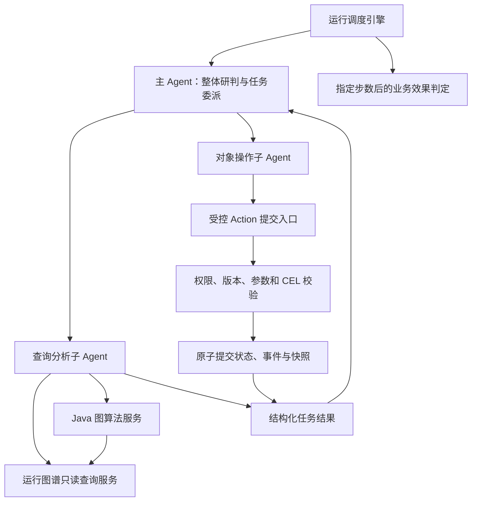

# 多智能体改造方式

本文汇总代码分析、主 Agent 与子 Agent 的改造方案，以及与当前平级 Agent 结构的比较。分析基于项目使用的 AgentScope Java 2.0.5。本文为设计讨论记录，尚未实施主从调度改造。

## 1. 改造目标与建议

希望由一个主 Agent 进行整体研判，按需要调用专业子 Agent：查询图谱、分析关系与算法指标、执行对象操作，并根据反馈调整后续安排。

建议采用以下职责划分：

- **主 Agent**：理解场景目标、确定调查重点、分解与委派任务、汇总结果、安排下一步。
- **子 Agent**：完成范围明确的查询、分析或操作任务，并返回结构化结果。
- **执行引擎**：校验权限、状态版本、参数和 Action 前置条件，提交状态变化并进行业务效果判定。

第一阶段建议采用轻量结构：**一个主 Agent、一个查询分析子 Agent、一个对象操作子 Agent**。查询分析子 Agent 复用现有图查询及 Java 图算法；需要更复杂的算法选择与解释时，再拆出独立的图算法分析 Agent。

## 2. 当前结构与行为

目前调查、响应等 Agent 是平级角色，围绕同一个运行图谱工作。场景中的 `agents` 数组决定调用顺序；运行过程中不会自动调整顺序。

一轮内，系统按顺序让尚未结束、未耗尽决策预算的 Agent，各进行至多一次决策。每次决策最终提出一个 Action，由引擎校验并执行。后面的 Agent 可以看到前面 Agent 提交后的最新状态。

一次 Agent 决策可能包含多次模型请求和只读工具调用，因此“每轮一次 Agent 决策”不等于“每轮只请求一次 LLM”。

默认双 Agent 泄密场景中：

| 角色 | 职责与权限 |
| --- | --- |
| 调查 Agent | 分析关系、标记对象已审查、结束自己的任务 |
| 响应 Agent | 撤销共享、禁用同步、标记对象已审查、结束自己的任务 |

二者通过共享状态间接配合，没有直接的任务交接。调查 Agent 的分析理由不会自动成为响应 Agent 的待办；响应 Agent 主要接收最新可见图谱、输入事件及自己的历史反馈。

### 2.1 代码基础

| 代码位置 | 当前作用 | 改造意义 |
| --- | --- | --- |
| `RunService.stepRound()` | 遍历场景 Agent，依次观察、决策、执行、提交 | 需要增加按任务委派的调度模式 |
| `DecisionProvider` | 返回一个 `Decision` | 需要表达主 Agent 委派、子任务结果与轮次摘要 |
| `AgentScopeDecisionProvider.decide()` | 每次创建并关闭 `ReActAgent`，注册观察工具 | 可提取 Agent 构建与模型适配，增加主从角色工具集 |
| `ObservationTools` | 查询本次决策的观察快照 | 可复用能力，但需要独立的运行图谱查询服务 |
| `GraphQueries` | 基于授权图数据计算路径、可达范围、中心性等 | 可作为查询分析子 Agent 的确定性工具 |
| `DeclarativeActionEngine` | 校验和原子执行 CEL 与声明式 Action | 保留为状态变更的唯一执行入口 |
| `HistoryService` | 回放与分支继承 | 需要明确继承任务、计划、子会话及效果评估上下文 |

## 3. AgentScope 2.0.5 的适用机制

已核对项目本地依赖的类及源码，具备以下能力：

- `Toolkit.registration().subAgent(...)`：将子 Agent 注册为主 Agent 可调用的工具。
- `SubAgentProvider`：通过工厂提供 Agent 实例。
- `SubAgentConfig`：配置工具名称、描述、子会话状态存储和事件转发。
- `message` 与可选 `session_id`：支持开始子任务对话及继续已有子会话。
- `ToolkitConfig.parallel(...)`：控制工具并行或串行执行。

这些能力提供了主从调用基础，但不会自动替项目完成业务任务持久化、权限约束、Action 幂等、运行取消和效果判定。

第一阶段可使用现有 `ReActAgent` 和子 Agent 工具机制，不必仅为实现主从结构而引入更重的工作区或团队协作体系。具体接入仍应以锁定版本的 API 为准。

参考源码：

- [AgentScope 2.0.5 Toolkit](https://github.com/agentscope-ai/agentscope-java/blob/v2.0.5/agentscope-core/src/main/java/io/agentscope/core/tool/Toolkit.java)
- [AgentScope 2.0.5 SubAgentTool](https://github.com/agentscope-ai/agentscope-java/blob/v2.0.5/agentscope-core/src/main/java/io/agentscope/core/tool/subagent/SubAgentTool.java)

## 4. 目标结构

主 Agent 决定做什么、调用谁；运行引擎负责实际调度、约束和记录。子 Agent 不直接写数据库，也不能绕过对象 Action 修改图谱。

图查询与算法本身仍是工具。对于参数已明确的对象详情、邻接关系查询，可以直接执行受控工具，不必为每次简单查询增加一次子 Agent 推理。复杂的查询组织、算法选择和结果解释，再交给查询分析子 Agent。

### 4.1 后续可拆分的角色

| 角色 | 主要工作 | 结果 |
| --- | --- | --- |
| 主 Agent | 确定重点、委派、汇总和调整计划 | 子任务、研判摘要、下一步安排 |
| 图谱查询 Agent | 查对象、入向/出向关系、邻接对象、局部图谱 | 带版本和范围的查询结果 |
| 图算法分析 Agent | 选择算法、组织参数、解释指标 | 可达范围、路径、关键对象候选及分析依据 |
| 对象操作 Agent | 将处置目标转换为合法对象 Action 并提交 | 引擎接受或拒绝的执行回执 |

现有路径、可达范围、度数、介数中心性等算法可以复用。最小割等尚未实现的算法，需要另行增加；算法结果由算法服务计算，Agent 负责选择与解释。局部图上的指标不能冒充整个图谱的结论，可达性也不能作为已发生传播的事实。

## 5. 泄密场景的协作示例

1. 主 Agent 收到“文件 F 存在潜在泄密信号”，确定需要调查的对象范围。
2. 委派查询任务：查询文件 F 的访问者、存储系统和关联出向关系。
3. 查询结果返回：文件 F 关联人员 A/B 和系统 S，另有 A → C 的共享、S → T 的同步。
4. 主 Agent 判断需要进一步分析潜在影响，委派可达范围或路径分析任务。
5. 查询分析子 Agent 返回证据引用、路径、状态版本和结果限制。
6. 主 Agent 委派处置任务：撤销人员 A 向 C 的共享。
7. 操作子 Agent 查询当前能力、补齐参数，提交 `REVOKE_SHARING`。
8. 引擎校验并执行，返回实际影响关系和提交前后版本。
9. 主 Agent 根据执行回执决定检查最新状态、处理其他通道或结束本轮。

调用顺序由任务依赖与结果决定。某轮可以只查询，某轮需要算法分析，某轮才执行处置；不再要求所有子 Agent 每轮都执行一次。

## 6. 运行图谱的按需查询

目前 `ObservationTools` 只查询本次观察快照。要支持“再看看某个对象是否还有关联对象”，建议增加统一的运行图谱只读服务，例如 `RunGraphReadService`。

该服务应支持：

- 根据运行 ID 和状态版本读取图谱。
- 查询对象详情、邻接关系、关系方向与类型、分页及局部展开。
- 返回读取版本、授权范围、结果是否截断及是否还有数据。
- 由服务端绑定权限和任务范围，防止模型通过参数扩大查询权限。

不能直接把面向世界模板的 `WorldService.expand/path` 当作运行查询入口。推演中已经关闭的关系、已生成的交易等，应以运行状态及其版本为准。

空结果应表述为“当前授权范围内未发现”。查询范围不完整时，分析报告应明确这一限制。

## 7. 任务协议、状态和记忆

不能仅使用自然语言消息连接父子 Agent。应定义并验证结构化任务与结果，至少包括：

| 数据 | 建议记录内容 |
| --- | --- |
| 任务 | 运行 ID、轮次、任务 ID、父任务 ID、执行角色、目标、对象范围、读取版本、允许的行动和预算 |
| 查询/分析结果 | 发现、对象和关系引用、算法及参数、读取版本、范围与限制 |
| 执行回执 | Action、参数、接受/拒绝原因、实际影响对象和关系、提交前后版本 |
| 主 Agent 研判 | 引用的子任务结果、简短理由、后续安排、待解决问题 |

子 Agent 声称“已经执行”不能作为成功依据，必须关联引擎提交的回执。

第一阶段建议子任务默认独立执行；需要追问时再续接子会话。主 Agent 的计划、任务与结果应持久化，不能只依赖进程内记忆。子任务完成表示该任务结束，不意味着子 Agent 永久退出后续调度。

会话应按运行、Agent 和任务进行隔离，避免不同运行或分支共享错误上下文。回放只读取已有记录，不重新调用模型或执行 Action。创建分支时，应明确复制哪些历史任务和研判，不能继承分支点之后的结果。

## 8. 轮数、预算与业务效果

新模式建议定义：**一轮是主 Agent 完成一次“研判、有限委派、获取反馈、更新安排”的闭环。**

需额外限制每轮的委派次数、Action 提交次数、工具调用及模型请求。第一阶段可默认每轮最多提交一个业务 Action，查询分析另设配额；以后是否允许多个 Action，可作为配置扩展。

如果不限制轮内工作量，主 Agent 可能在一轮里不断调用子 Agent，最大轮数就失去了控制作用。主 Agent 与所有子 Agent 的请求、耗时和 Token 都应纳入全局预算，不能只统计顶层决策。当前固定请求数和 Token 预留估算，不适合直接套用到嵌套调用。

业务效果仍采用此前讨论的方式：到指定轮数后，由引擎按场景目标判断成功或失败。主 Agent 的总结、子任务完成或 Agent 提交 `END`，均不能替代业务效果判定。详细讨论见 [场景效果判定](场景效果判定.md)。

## 9. 必须处理的工程问题

### 9.1 运行锁与状态提交

当前 `RunService.step()` 在完整轮次期间持有 `synchronized` 锁，包括等待模型返回。`intervene()` 同时要求运行处于暂停状态。

不能把现有 `intervene()` 原样注册为子 Agent 的执行工具：运行状态可能不允许调用，子线程也可能等待父线程所持有的锁。

建议使用每个运行的执行令牌及串行命令提交机制。模型调用期间不持有状态写锁；提交时检查运行状态、预期版本、权限和取消标记。不同运行避免被一个全局锁相互阻塞。

### 9.2 模型并发名额

目前整个 `decide()` 期间占用模型并发信号量。如果主 Agent 占住唯一名额，又等待使用同一模型的子 Agent，子 Agent 可能无法获得调用名额。

并发控制应围绕实际模型请求，不应覆盖整段父子协作过程。

### 9.3 跟踪、幂等和取消

现有 `ThreadLocal` 工具记录不足以表达嵌套与异步任务。需要显式传递父子调用上下文，记录任务、工具、模型请求、Action 和提交事件之间的关联。

Action 重试必须去重，尤其是执行成功但回执返回失败的情况。暂停或停止后，尚未返回的子任务不能继续提交状态。过期状态上的查询和计划需要刷新或重新研判，不能静默覆盖新版本。

第一阶段建议串行委派子 Agent、串行提交状态；后续再允许同一快照上的独立只读任务并行执行。

## 10. 与当前方案比较

| 比较项 | 当前平级 Agent | 主 Agent 与子 Agent |
| --- | --- | --- |
| 整体规划 | 各角色围绕自己的目标决策 | 主 Agent 统一确定重点和下一步 |
| 执行顺序 | 固定数组顺序 | 根据任务需要动态委派 |
| 信息交接 | 主要通过共享状态间接配合 | 任务、报告和回执明确关联 |
| 查询与分析 | 每个 Agent 带一组图工具 | 专业能力按需调用 |
| 上下文 | 各角色自行理解观察数据 | 主 Agent 获取汇总，子 Agent 获取专项上下文 |
| 调用成本 | 调度简单，但可能有重复决策 | 可减少无关调用，也会增加委派与汇总开销 |
| 问题排查 | 调用链较短 | 需跟踪父子任务及多次模型调用 |
| 实现难度 | 当前已实现 | 需要改造调度、预算、持久化和取消机制 |

### 10.1 主要收益

- 调查发现、处置任务和执行反馈能够形成明确闭环。
- 按需查询和执行，不必每轮调度所有角色。
- 可针对子任务控制上下文和权限，减少无关信息。
- 图谱查询、算法与操作能力可跨泄密、银行等场景复用。
- 可以展示主 Agent 如何依据子任务结果调整安排，提高过程可解释性。

### 10.2 主要代价与风险

- 主 Agent 可能成为瓶颈，其遗漏或错误判断会影响后续任务方向。
- 子任务摘要可能丢失细节，需要保留证据和版本引用。
- 简单操作可能需要多次父子模型交互，费用和延迟不一定降低，需实测比较。
- 对持久化、权限、幂等、恢复和预算统计的要求明显提高。
- Agent 数量增加不会自动保证效果；业务正确性仍依赖可信数据、执行校验和效果规则。

对于只有七个对象的泄密示例，完整主从体系可能偏重。对于后续多场景、按需查图、图算法和连续处置任务，主从结构更符合扩展方向。

## 11. 分阶段实施建议

1. **建立最小主从闭环。** 增加新的调度模式，采用一个主 Agent、查询分析子 Agent 和对象操作子 Agent；完成任务协议、受控查询、Action 回执、预算和事件关联。保留旧运行的冻结配置及回放能力。
2. **完善业务与展示。** 完整改造泄密场景，加入指定步数后的效果判定，并将 Agent 活动展示为主 Agent 研判及子任务树；随后迁移银行场景。
3. **按需要扩展。** 算法任务复杂后拆出独立图算法 Agent，再考虑并行只读任务、子会话续接及更多专业角色。

验收不应只检查子 Agent 能否调用成功，还应覆盖：实际反馈能否改变主 Agent 后续安排、查询是否基于正确版本、Action 重试是否重复执行、暂停后是否仍有写入、运行与分支是否隔离、失败原因能否追溯，以及模型请求与 Token 成本是否合理。

本方案的推荐起点是轻量主从结构，优先获得明确的整体研判和任务交接能力，再根据业务复杂度增加角色及并发能力。
